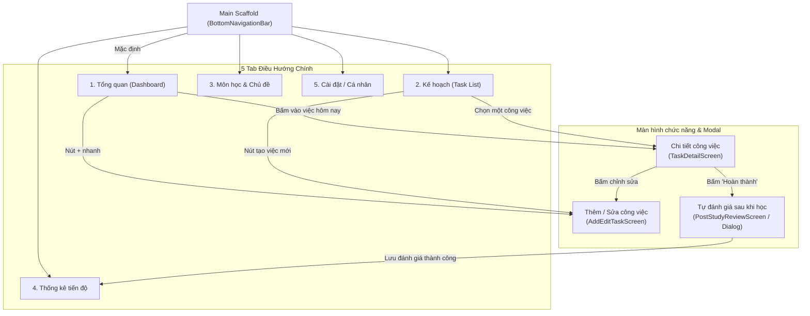
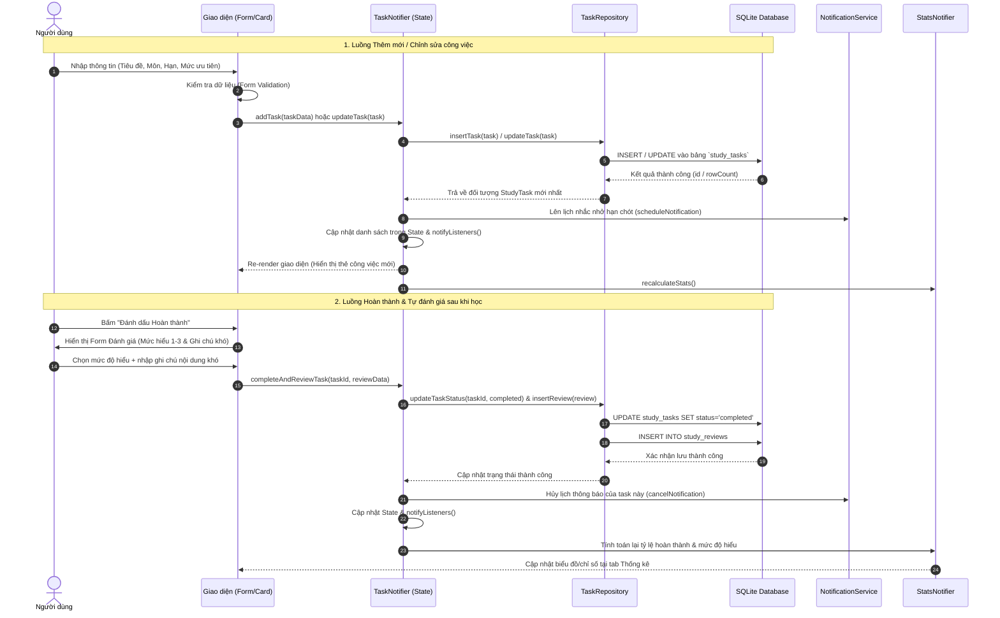
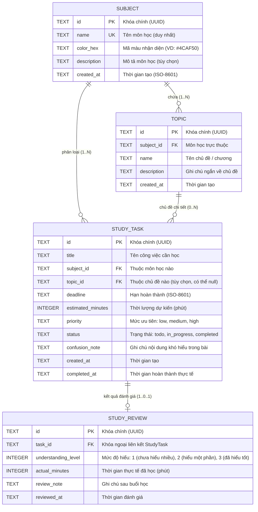

# TÀI LIỆU THIẾT KẾ KIẾN TRÚC MỤC TIÊU - EXAMPILOT

> **Dự án**: ExamPilot – Ứng dụng lập kế hoạch và theo dõi học tập cá nhân  
> **Nền tảng**: Flutter (Ưu tiên Android Mobile, Giao diện Tiếng Việt)  
> **Trạng thái**: Thiết kế kiến trúc mục tiêu trước khi triển khai (Target Architecture)  
> **Công cụ trực quan hóa**: Archify v3.2 & Mermaid  

---

## 1. Xác minh công cụ Archify

Skill **Archify** đã được kiểm tra và hoạt động hoàn chỉnh trên môi trường hiện tại (`Node.js v24.15.0`). Toàn bộ 5 sơ đồ kiến trúc mục tiêu đã được biên dịch thành công thành các tệp HTML độc lập (standalone), có tính năng chuyển đổi giao diện Sáng/Tối, diễn hoạt (motion), tìm kiếm và xuất ảnh/SVG tại thư mục `docs/architecture/diagrams/`:

1. [Sơ đồ A — Kiến trúc tổng thể](diagrams/diagram_a_architecture.html)
2. [Sơ đồ B — Điều hướng màn hình](diagrams/diagram_b_navigation.html)
3. [Sơ đồ C — Luồng dữ liệu công việc](diagrams/diagram_c_task_flow.html)
4. [Sơ đồ D — Mô hình dữ liệu (ERD)](diagrams/diagram_d_erd.html)
5. [Sơ đồ E — Lộ trình triển khai](diagrams/diagram_e_roadmap.html)

Đồng thời, tài liệu này tích hợp sẵn mã nguồn **Mermaid** của từng sơ đồ để người đọc có thể xem trực tiếp ngay trong trình đọc Markdown.

---

## 2. Các sơ đồ kiến trúc chi tiết

### Sơ đồ A — Kiến trúc tổng thể (Overall Architecture)

- **Liên kết file tương tác HTML**: [`docs/architecture/diagrams/diagram_a_architecture.html`](diagrams/diagram_a_architecture.html)
- **Mô hình kiến trúc**: Layered Architecture (Kiến trúc phân tầng) kết hợp mô hình Offline-First.

```mermaid
graph TD
    subgraph Presentation_Layer ["Tầng Giao Diện (Presentation Layer)"]
        UI_Screens["Màn hình (Screens)<br/>Overview, Plan, Subjects, Stats, Review"]
        UI_Widgets["Thành phần dùng lại (Widgets)<br/>TaskCard, SubjectChip, PriorityBadge"]
    end

    subgraph Logic_Layer ["Tầng Nghiệp Vụ & State (Business Logic Layer)"]
        State_Notifiers["Quản lý trạng thái (ChangeNotifier / Provider)<br/>TaskNotifier, SubjectNotifier, StatsNotifier"]
        Notif_Service["Dịch vụ thông báo (NotificationService)<br/>flutter_local_notifications"]
        Future_AI["Dịch vụ AI tương lai (Future AI Service)<br/>Gemini API Client (Tùy chọn mở rộng)"]
    end

    subgraph Data_Layer ["Tầng Dữ Liệu (Data Layer)"]
        Repositories["Tầng Repository<br/>TaskRepository, SubjectRepository, ReviewRepository"]
        Models["Mô hình thực thể (Models)<br/>StudyTask, Subject, Topic, StudyReview"]
    end

    subgraph Local_Storage ["Lưu Trữ Cục Bộ (Local Storage Layer)"]
        SQLite_DB[("SQLite Database (sqflite)<br/>Bảng tasks, subjects, topics, reviews")]
        Shared_Prefs[("SharedPreferences<br/>Cài đặt giờ nhắc, Theme, Tùy chọn")]
    end

    %% Dependencies
    UI_Screens --> UI_Widgets
    UI_Screens -->|gửi action / lắng nghe state| State_Notifiers
    State_Notifiers -->|lên lịch nhắc nhở| Notif_Service
    State_Notifiers -.->|gợi ý phân bổ học tập (mở rộng)| Future_AI
    State_Notifiers -->|gọi thao tác CRUD| Repositories
    Repositories -->|chuyển đổi object/map| Models
    Repositories -->|truy vấn SQL| SQLite_DB
    State_Notifiers -->|lưu cấu hình cá nhân| Shared_Prefs
```

#### Giải thích tầng kiến trúc:
1. **Presentation Layer (Giao diện)**: Gồm các màn hình và widget hiển thị. Chỉ chịu trách nhiệm hiển thị dữ liệu và tiếp nhận tương tác từ người dùng (bấm nút, nhập form).
2. **Business Logic Layer (Xử lý nghiệp vụ)**: Sử dụng mô hình `ChangeNotifier` / `Provider` đơn giản, trực quan cho sinh viên. Quản lý trạng thái danh sách công việc, tính toán chỉ số, giao tiếp với Repository và kích hoạt thông báo cục bộ.
3. **Data Layer (Tầng dữ liệu)**:
   - **Models**: Định nghĩa các lớp dữ liệu và hàm chuyển đổi hai chiều `toMap()` / `fromMap()` cho SQLite.
   - **Repositories**: Đóng vai trò cầu nối, che giấu các câu lệnh SQL cụ thể phía dưới, giúp tầng Logic không cần quan tâm dữ liệu được lưu bằng cách nào.
4. **Local Storage (Lưu trữ cục bộ)**: Cơ sở dữ liệu SQLite (`sqflite`) lưu dữ liệu có cấu trúc quan hệ; `SharedPreferences` lưu các thiết lập cá nhân đơn giản. Hoạt động offline 100%, không cần kết nối internet hay backend phức tạp.
5. **Notification Service**: Chạy cục bộ trên thiết bị Android bằng `flutter_local_notifications` để hẹn giờ thông báo học tập.
6. **Future AI Service**: Thiết kế độc lập dưới dạng một Service rời, sẵn sàng kết nối với Google Gemini API trong tương lai mà không làm vỡ kiến trúc cốt lõi.

---

### Sơ đồ B — Điều hướng màn hình (Screen Navigation Flow)

- **Liên kết file tương tác HTML**: [`docs/architecture/diagrams/diagram_b_navigation.html`](diagrams/diagram_b_navigation.html)



#### Giải thích luồng điều hướng:
- Cấu trúc thanh điều hướng dưới (**BottomNavigationBar**) gắn chặt với 5 màn hình chính giúp người dùng chuyển đổi nhanh chóng.
- Màn hình **Thêm/Sửa công việc** dùng chung một Form Screen, mở dưới dạng modal hoặc trang push thông thường khi bấm nút `+` từ Tab Tổng quan hoặc Tab Kế hoạch.
- Khi người dùng học xong và ấn nút **Hoàn thành** tại Màn hình chi tiết, hệ thống tự động mở Màn hình/Hộp thoại **Tự đánh giá sau khi học** để ghi nhận mức độ hiểu bài và ghi chú khó hiểu.

---

### Sơ đồ C — Luồng dữ liệu công việc (Task Data Flow)

- **Liên kết file tương tác HTML**: [`docs/architecture/diagrams/diagram_c_task_flow.html`](diagrams/diagram_c_task_flow.html)



#### Giải thích các nhánh luồng:
- **Thêm/Sửa (Create/Update)**: Form kiểm tra hợp lệ ngay tại tầng UI (tiêu đề không để trống, hạn chót phải từ hiện tại trở đi). Sau đó gửi xuống `TaskNotifier`, lưu bền vững vào SQLite và cập nhật lại bộ nhớ hiển thị ngay lập tức.
- **Xóa (Delete)**: Sau khi hiển thị hộp thoại xác nhận (Confirm Dialog), `TaskNotifier` gọi Repository xóa bản ghi trong SQLite, hủy thông báo tương ứng và gọi `notifyListeners()`.
- **Hoàn thành & Đánh giá (Complete & Review)**: Trạng thái task chuyển sang `completed`. Hệ thống kích hoạt lưu bản ghi `StudyReview` liên kết 1-1 với task, đồng thời kích hoạt `StatsNotifier` tính lại các chỉ số phần trăm hoàn thành và phân bổ mức độ hiểu bài.

---

### Sơ đồ D — Mô hình dữ liệu (Data Model / ERD)

- **Liên kết file tương tác HTML**: [`docs/architecture/diagrams/diagram_d_erd.html`](diagrams/diagram_d_erd.html)



#### Giải thích quan hệ và trường dữ liệu:
- **`Subject` (Môn học)**: Thực thể danh mục gốc. Cung cấp màu sắc (`color_hex`) để gắn chip hiển thị trực quan trên giao diện lịch và thẻ công việc.
- **`Topic` (Chủ đề / Bài học)**: Trực thuộc một môn học cụ thể (`subject_id`). Cho phép người học chia nhỏ nội dung môn học. (Là tùy chọn, không bắt buộc mọi task đều phải có topic).
- **`StudyTask` (Công việc học tập)**: Thực thể trung tâm. Chứa hạn chót (`deadline`), thời lượng (`estimated_minutes`), độ ưu tiên (`priority`), trạng thái (`status`), và đặc biệt là trường `confusion_note` để ghi lại những khái niệm khó ngay trong lúc học.
- **`StudyReview` (Đánh giá sau khi học)**: Tách riêng hoặc liên kết 1-1 với `StudyTask`. Lưu mức độ hiểu (`1 - Chưa hiểu nhiều`, `2 - Hiểu một phần`, `3 - Đã hiểu tốt`) và thời gian học thực tế. Trường này phục vụ trực tiếp cho chức năng thống kê học tập.

---

### Sơ đồ E — Lộ trình triển khai (8 Giai đoạn)

- **Liên kết file tương tác HTML**: [`docs/architecture/diagrams/diagram_e_roadmap.html`](diagrams/diagram_e_roadmap.html)

```mermaid
flowchart LR
    subgraph Part1 ["Chặng 1: Nền tảng & CRUD Cốt lõi (Ưu tiên làm trước)"]
        direction TB
        G1["Giai đoạn 1<br/><b>Thiết lập cấu trúc & UI Base</b><br/>• Scaffolding, Theme<br/>• 5 Tab BottomNavigationBar"]
        G2["Giai đoạn 2<br/><b>CRUD Công việc (Mock Data)</b><br/>• Thêm, Xem, Sửa, Xóa<br/>• Quản lý State trên RAM"]
        G3["Giai đoạn 3<br/><b>Lưu trữ cục bộ SQLite</b><br/>• Tích hợp sqflite<br/>• TaskRepository lưu bền vững"]
        G4["Giai đoạn 4<br/><b>Quản lý Môn học & Chủ đề</b><br/>• Thêm môn, gắn màu sắc<br/>• Lọc công việc theo môn"]
        G1 --> G2 --> G3 --> G4
    end

    subgraph Part2 ["Chặng 2: Nghiệp vụ học tập & Nâng cao (Làm sau)"]
        direction TB
        G5["Giai đoạn 5<br/><b>Tự đánh giá sau khi học</b><br/>• 3 mức độ hiểu bài<br/>• Ghi chú nội dung khó hiểu"]
        G6["Giai đoạn 6<br/><b>Báo cáo & Thống kê tiến độ</b><br/>• Tính tỷ lệ từ dữ liệu thực<br/>• Biểu đồ mức độ hiểu"]
        G7["Giai đoạn 7<br/><b>Nhắc nhở học tập</b><br/>• flutter_local_notifications<br/>• Nhắc trước hạn hoàn thành"]
        G8["Giai đoạn 8<br/><b>Kiểm thử & Hook mở rộng AI</b><br/>• Tối ưu UI/UX, sửa lỗi<br/>• Cắm giao diện Gemini gợi ý"]
        G5 --> G6 --> G7 --> G8
    end

    G4 --> G5
```



---

## 3. Cấu trúc thư mục Flutter đề xuất

Để phù hợp với sinh viên mới học Flutter và dự án thực hiện trong thời gian ngắn, cấu trúc thư mục được thiết kế theo mô hình **Layered Architecture kết hợp Feature UI Modules**, tránh việc phân tách quá nhiều tầng trừu tượng không cần thiết:

```text
lib/
├── core/                         # Các thành phần cốt lõi dùng chung toàn ứng dụng
│   ├── constants/
│   │   ├── app_colors.dart       # Bảng màu chủ đạo, màu các mức ưu tiên
│   │   ├── app_strings.dart      # Chuỗi hiển thị tiếng Việt cố định
│   │   └── app_themes.dart       # Light / Dark ThemeData
│   ├── enums/
│   │   ├── task_priority.dart    # enum TaskPriority { low, medium, high }
│   │   ├── task_status.dart      # enum TaskStatus { todo, inProgress, completed }
│   │   └── understanding_level.dart # enum UnderstandingLevel { poor, fair, good }
│   ├── database/
│   │   ├── database_helper.dart  # Khởi tạo SQLite DB, quản lý phiên bản và bảng
│   │   └── db_constants.dart     # Tên bảng và tên các cột trong CSDL
│   └── utils/
│       ├── date_time_utils.dart  # Format ngày tháng tiếng Việt (dd/MM/yyyy HH:mm)
│       └── validators.dart       # Hàm kiểm tra rỗng, kiểm tra thời lượng hợp lệ
├── models/                       # Các Data Model thuần túy
│   ├── subject_model.dart        # Model Môn học
│   ├── topic_model.dart          # Model Chủ đề
│   ├── study_task_model.dart     # Model Công việc học tập
│   └── study_review_model.dart   # Model Đánh giá sau học
├── repositories/                 # Tầng tương tác CSDL SQLite
│   ├── task_repository.dart      # Truy vấn CRUD bảng tasks
│   ├── subject_repository.dart   # Truy vấn bảng subjects & topics
│   └── review_repository.dart    # Truy vấn bảng reviews & tính aggregate
├── services/                     # Các dịch vụ hệ thống & mở rộng
│   ├── notification_service.dart # Đặt lịch & hủy thông báo cục bộ
│   └── ai_study_service.dart     # (Tùy chọn tương lai) Kết nối AI Gemini
├── providers/                    # Tầng quản lý trạng thái (ChangeNotifier)
│   ├── task_provider.dart        # Quản lý danh sách task, lọc, thêm/sửa/xóa
│   ├── subject_provider.dart     # Quản lý danh mục môn học
│   └── statistics_provider.dart  # Tính toán thống kê từ dữ liệu thực tế
├── screens/                      # Màn hình giao diện người dùng
│   ├── app_shell.dart            # Màn hình khung chứa BottomNavigationBar 5 tab
│   ├── overview/                 # Tab 1: Tổng quan tiến độ hôm nay & việc gấp
│   │   └── overview_screen.dart
│   ├── tasks/                    # Tab 2: Danh sách kế hoạch học tập
│   │   ├── task_list_screen.dart
│   │   ├── task_detail_screen.dart
│   │   └── add_edit_task_screen.dart
│   ├── subjects/                 # Tab 3: Quản lý môn học & chủ đề
│   │   └── subject_screen.dart
│   ├── statistics/               # Tab 4: Thống kê & tỷ lệ hoàn thành
│   │   └── statistics_screen.dart
│   ├── review/                   # Màn hình/Hộp thoại tự đánh giá sau khi học
│   │   └── post_study_review_dialog.dart
│   └── settings/                 # Tab 5: Cài đặt giờ nhắc nhở & thông tin
│       └── settings_screen.dart
├── widgets/                      # Các thành phần giao diện dùng chung
│   ├── task_card.dart            # Thẻ hiển thị công việc (tiêu đề, hạn, môn)
│   ├── priority_badge.dart       # Huy hiệu mức ưu tiên (Cao/Vừa/Thấp)
│   ├── subject_chip.dart         # Tag môn học có màu đại diện
│   └── progress_bar_card.dart    # Thẻ thanh tiến độ hoàn thành
└── main.dart                     # Khởi chạy app, nạp MultiProvider & cấu hình
```

---

## 4. Danh sách Model và Trách nhiệm

| Model | Trách nhiệm chính | Các trường thuộc tính quan trọng |
|---|---|---|
| **`Subject`** | Đại diện cho môn học; quản lý màu sắc nhận diện để trực quan hóa trên lịch và danh sách công việc. | `id`, `name`, `colorHex`, `description`, `createdAt` |
| **`Topic`** | Đại diện cho chương hoặc chủ đề trong môn học; giúp phân nhỏ bài học khi cần thiết. | `id`, `subjectId`, `name`, `description`, `createdAt` |
| **`StudyTask`** | Thực thể trung tâm lưu trữ thông tin công việc: nội dung cần học, hạn chót, thời gian dự kiến, mức độ ưu tiên và các ghi chú khó hiểu phát sinh. | `id`, `title`, `subjectId`, `topicId`, `deadline`, `estimatedMinutes`, `priority`, `status`, `confusionNote`, `createdAt`, `completedAt` |
| **`StudyReview`** | Lưu kết quả phản hồi của sinh viên ngay sau buổi học: mức độ nắm bắt bài học, thời gian học thực tế và ghi chú sau khi học. | `id`, `taskId`, `understandingLevel` (1..3), `actualMinutes`, `reviewNote`, `reviewedAt` |
| **Enums** | Định nghĩa các tập giá trị chuẩn để tránh lỗi gõ sai chuỗi ký tự trong toàn bộ logic và CSDL. | `TaskPriority` (low, medium, high), `TaskStatus` (todo, inProgress, completed), `UnderstandingLevel` (poor, fair, good) |

---

## 5. Lựa chọn Lưu trữ cục bộ đề xuất & Lý do

### Giải pháp đề xuất: **SQLite (thông qua package `sqflite`)**

#### Lý do lựa chọn:
1. **Phù hợp bản chất dữ liệu quan hệ**: ExamPilot có cấu trúc dữ liệu liên kết rõ ràng: `Subject` $\rightarrow$ `Topic` $\rightarrow$ `StudyTask` $\rightarrow$ `StudyReview`. SQLite hỗ trợ khóa ngoại (`FOREIGN KEY`) và xóa theo dòng (`CASCADE`), giúp bảo toàn tính toàn vẹn dữ liệu.
2. **Hỗ trợ truy vấn thống kê mạnh mẽ**: Khi làm tính năng Thống kê (Statistics), các câu truy vấn SQL như `COUNT()`, `SUM(actual_minutes)`, `GROUP BY understanding_level` sẽ tính toán trực tiếp từ CSDL một cách nhanh chóng và chính xác.
3. **Giá trị học tập cao cho sinh viên**: Kiến thức về CSDL quan hệ và SQL là kỹ năng nền tảng của ngành CNTT. Việc thực hành với `sqflite` giúp sinh viên hiểu sâu sắc về cách thức lưu trữ offline trên di động.
4. **Hoạt động hoàn toàn Offline**: Dữ liệu lưu trực tiếp vào bộ nhớ máy Android trong thư mục sandbox an toàn của ứng dụng, không cần internet và giữ nguyên trạng thái khi tắt/khởi động lại app.

*Lưu ý bổ sung*: Đối với các dữ liệu cài đặt nhỏ lẻ (như bật/tắt nhắc nhở, giờ nhận thông báo mặc định), sử dụng thêm **`SharedPreferences`** vì tính năng này lưu trữ dạng Key-Value cực kỳ nhẹ và tiện lợi.

---

## 6. Phân loại Chức năng: Làm trước (MVP) vs Làm sau

### Nhóm chức năng LÀM TRƯỚC (Ưu tiên cao - MVP cốt lõi)
1. **Quản lý công việc cơ bản (CRUD Task)**: Màn hình danh sách công việc, form tạo mới, xem chi tiết, chỉnh sửa và xóa task.
2. **Lưu trữ cục bộ với SQLite**: Đảm bảo tắt ứng dụng bật lại dữ liệu vẫn được lưu vĩnh viễn.
3. **Quản lý Môn học (Subject)**: Tạo danh mục môn học có màu sắc nhận diện để gắn vào từng task.
4. **Trạng thái & Mức độ ưu tiên**: Phân loại trạng thái (Chưa làm, Đang làm, Đã xong) và ưu tiên (Cao, Vừa, Thấp).
5. **Ghi chú nội dung khó hiểu & Tự đánh giá sau học**: Form đánh giá 3 mức độ hiểu bài khi hoàn thành công việc.
6. **Màn hình Tổng quan (Overview)**: Hiển thị các công việc cần làm hôm nay và thanh tiến độ hoàn thành đơn giản.

### Nhóm chức năng LÀM SAU (Nâng cao & Mở rộng)
1. **Thống kê tiến độ chuyên sâu**: Biểu đồ phân bổ mức độ hiểu theo môn học, tổng số giờ học thực tế.
2. **Nhắc nhở học tập (Local Notifications)**: Hẹn giờ thông báo trước hạn chót (cần xử lý quyền thông báo trên Android 13+).
3. **Quản lý Chủ đề chi tiết (Topic)**: Có thể ẩn hoặc gom chung với Môn học nếu thời gian làm bài hạn hẹp.
4. **Tích hợp AI gợi ý lịch học**: Kết nối Gemini API để đưa ra lời khuyên phân bổ thời gian học (tính năng mở rộng trong tương lai).

---

## 7. Các điểm cần đơn giản hóa cho sinh viên mới học Flutter

Để hoàn thành dự án đúng hạn, chất lượng cao và không bị quá tải kiến thức, nên áp dụng các giải pháp đơn giản hóa sau:

1. **Về Quản lý trạng thái (State Management)**:
   - *Khuyến nghị*: Dùng **`Provider` kết hợp `ChangeNotifier`**.
   - *Lý do*: Đây là giải pháp được tài liệu chính thức của Flutter khuyến nghị cho người mới bắt đầu. Rất dễ hiểu, ít code mẫu (boilerplate) hơn nhiều so với BLoC hoặc Clean Architecture phức tạp.
2. **Không làm chức năng Đăng nhập / Tài khoản**:
   - Ứng dụng là sổ tay học tập cá nhân cục bộ. Không cần Firebase Authentication hay đăng nhập tài khoản. Người dùng mở app là có thể sử dụng ngay lập tức.
3. **Đơn giản hóa Quản lý Chủ đề (Topic)**:
   - Trong giai đoạn đầu, có thể coi mỗi môn học là một đơn vị phân loại chính. Chưa cần bắt buộc người dùng phải tạo Topic rồi mới được tạo Task. Trường `topic_id` nên để là tùy chọn (nullable).
4. **Đơn giản hóa Giao diện Thống kê**:
   - Chưa cần nhúng các thư viện biểu đồ quá phức tạp như `fl_chart`. Có thể dùng các widget thanh tiến độ có sẵn của Flutter (`LinearProgressIndicator`, `CircularProgressIndicator`) và các thẻ đếm số (`Card` hiển thị: Đã xong 8/10, Hiểu tốt 75%).
5. **Đơn giản hóa tính năng AI**:
   - Ở giai đoạn này, chỉ cần thiết kế sẵn lớp trừu tượng `AIService` và giao diện mẫu (một nút "Gợi ý lịch học bằng AI" hiển thị lời khuyên mẫu hoặc gọi API đơn giản) mà không cần xây dựng cả hệ thống prompt engineering hay backend riêng.
6. **Tránh Clean Architecture quá nhiều tầng**:
   - Không nên tách riêng `Domain/UseCases/Entities/DataSources/DTOs` vì sẽ khiến sinh viên phải viết 4-5 file trung gian cho một thao tác đơn giản. Sử dụng mô hình `Screen -> Provider -> Repository -> SQLite` là vừa đủ chuẩn mực, sạch sẽ và dễ bảo trì.

