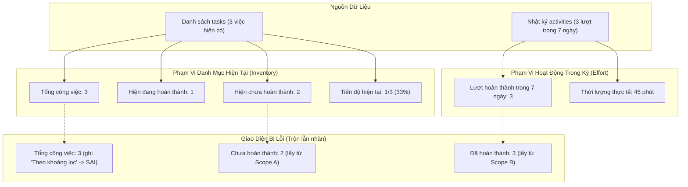
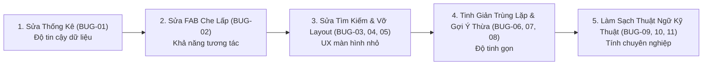

# BÁO CÁO G8.0: KIỂM TOÁN TOÀN DIỆN UX & SẢN PHẨM (EXAMPILOT)

> **Mã kiểm toán**: G8.0-AUDIT-FINAL  
> **Thời điểm thực hiện**: 11/11/2026  
> **Chế độ**: CHỈ KIỂM TOÁN (AUDIT ONLY – KHÔNG THAY ĐỔI MÃ NGUỒN)  
> **Đối tượng kiểm toán**: Ứng dụng ExamPilot (Flutter Android / Web Preview)  
> **Cơ sở dữ liệu**: SQLite v6 (`exampilot.db`) trên Android; `localStorage` trên Web  

---

## 1. TỔNG QUAN HIỆN TRẠNG SẢN PHẨM

ExamPilot đã hoàn thành nền tảng cốt lõi từ G1 đến G7.1 với kiến trúc Repository mẫu mực, quản lý 5 tab điều hướng chính: **Tổng quan, Kế hoạch, Môn học, Thống kê, Cá nhân**.

### Các thế mạnh kỹ thuật đã xây dựng được:
1. **Hệ thống dữ liệu chuẩn mực**: Phân tách rõ ràng giữa SQLite cục bộ trên Android và `localStorage` trên Web Preview thông qua conditional export (`web_storage_stub.dart` vs `web_storage_web.dart`), đạt 97/97 tests pass.
2. **Khả năng đóng gói độc lập**: Đã build thành công bản Release APK (`51.2 MB`) không phụ thuộc backend bên ngoài.
3. **Mô hình nghiệp vụ tự học đầy đủ**: Hỗ trợ độ ưu tiên, deadline, trạng thái, tự đánh giá mức độ hiểu bài 3 cấp độ (`UnderstandingLevel`), chuỗi học tập (`StudyStreak`) và mục tiêu hàng tuần (`UserProfile`).

### Các vấn đề UX và Sản phẩm cần giải quyết ở G8:
Mặc dù tính năng đầy đủ, ứng dụng hiện bộc lộ nhiều điểm nghẽn về trải nghiệm di động:
- **Trộn lẫn phạm vi số liệu (Scope Conflation) tại màn hình Thống kê**: Dẫn đến hiện tượng hiển thị số liệu mâu thuẫn trực tiếp (Tổng 3 việc, Đã xong 3, Chưa xong 2, Tiến độ 1/3).
- **Thành phần giao diện che khuất nội dung (FAB Collision)**: Floating Action Button che khuất phần tử cuối danh sách ở cả tab Tổng quan và Kế hoạch do thiếu bottom safe-area padding.
- **Trùng lặp thành phần điều hướng**: Nhiều nút trùng chức năng xuất hiện cùng lúc (2 nút "Thêm việc" trên Dashboard; nhiều lối tắt sang tab Kế hoạch/Môn học dù đã có thanh NavigationBar).
- **Màn hình hẹp bị ép chữ và vỡ nhãn**: Tiêu đề và nút sắp xếp ở Kế hoạch bị chật chội; lưới 4 cột chỉ số ở Chi tiết môn học bị tràn chữ (`Chưa ho...`).
- **Lộ thông tin nội bộ của nhà phát triển**: Hiển thị phiên bản database "v6", phase dự án "Giai đoạn 6 - Hoàn thiện UI/UX" và các tùy chọn khôi phục dữ liệu mẫu phục vụ test ngay trong màn hình cài đặt của người dùng cuối.

---

## 2. ĐÁNH GIÁ CHI TIẾT TỪNG MÀN HÌNH

### A. Màn hình Tổng quan (OverviewScreen)
- **Thứ tự thông tin**: Lời chào $\rightarrow$ Thẻ Study Streak $\rightarrow$ Thẻ tiến độ hôm nay $\rightarrow$ Cần làm hôm nay $\rightarrow$ Quá hạn $\rightarrow$ Sắp đến hạn $\rightarrow$ Lối tắt nhanh.
  - *Bất cập*: Thẻ Streak quá to (~280dp) đẩy toàn bộ nhiệm vụ của ngày xuống dưới màn hình (below the fold). Công việc "Quá hạn" (khẩn cấp nhất) lại bị xếp dưới mục "Cần làm hôm nay".
- **Nội dung bị lặp**:
  - Nút `Thêm việc` dạng `FilledButton.icon` ở góc trên bên phải xuất hiện đồng thời với nút `FloatingActionButton.extended` ở góc dưới bên phải.
  - Các nút `Xem kế hoạch`, `Xem tất cả` và hai thẻ `InfoCard` cuối trang đều thực hiện cùng một thao tác điều hướng sang tab Kế hoạch và Môn học.
- **Che khuất nội dung**: `SingleChildScrollView` chỉ có padding đáy `16dp`. Nút FAB cố định ở góc dưới che mất thẻ `InfoCard` cuối cùng khi cuộn hết trang.
- **Trạng thái rỗng**: Khi người dùng chưa tạo công việc nào, màn hình hiển thị 2 khối rỗng liên tiếp ("Hôm nay không có hạn bài tập nào" và "Không có công việc nào sắp đến hạn") mà không có một lời kêu gọi hành động (Call-To-Action) trọng tâm hướng dẫn bắt đầu.

### B. Màn hình Kế hoạch (PlanScreen)
- **Tiêu đề và Sắp xếp**: Hàng tiêu đề đặt `Expanded(Text('Kế hoạch học tập'))` cạnh nút `PopupMenuButton` chứa nhãn dài ("Ưu tiên cao → thấp", "Hạn chót gần nhất"). Trên màn hình điện thoại có chiều rộng $\le 360\text{dp}$, tiêu đề bị ép hẹp và ngắt dòng xấu.
- **Bộ lọc Trạng thái và Môn học**: Tách thành 2 hàng cuộn ngang riêng biệt (`FilterChip` cho trạng thái và `ActionChip` cho môn học), chiếm dụng đến gần 100dp chiều cao giao diện trước khi người dùng nhìn thấy công việc đầu tiên.
- **Hạn chế tìm kiếm**: Ô tìm kiếm thời gian thực chỉ so khớp `task.title` và `task.notes`. Nếu người dùng gõ tên môn học (như "Toán", "Web") vào ô tìm kiếm thì ứng dụng báo "Không tìm thấy kết quả" dù các bài tập môn đó hiển thị ngay bên dưới.
- **Che khuất do FAB**: `ListView` có `padding: EdgeInsets.symmetric(vertical: 16)`. Khi danh sách có nhiều bài tập, thẻ công việc cuối cùng bị nút FAB che lấp hoàn toàn nửa dưới và menu thao tác ba chấm.
- **Kích thước thẻ công việc**: Thẻ `TaskCard` hiển thị quá nhiều huy hiệu (môn, ưu tiên, đang làm, mức độ hiểu, ghi chú) khiến chiều cao thẻ lớn (~130dp), chỉ hiển thị được 2-3 việc trên một màn hình điện thoại.

### C. Màn hình Môn học & Chi tiết môn học
- **Tính đúng đắn của liên kết `subjectId`**:
  - `Tasks` liên kết chính xác qua `t.subjectId == subject.id` kèm fallback an toàn theo tên môn cho các bản ghi cũ.
  - Khi cập nhật tên môn học, hệ thống đồng bộ tự động `subject` trong `study_tasks`.
  - Khi thêm việc từ màn hình môn, `preselectedSubjectId` được gán chính xác.
- **Tiến độ và số công việc**: Được tính toán theo thời gian thực từ danh sách công việc hiện có, hiển thị tỷ lệ % và số việc đã hoàn thành/tổng số việc.
- **Cơ chế xóa an toàn**: Khi môn học còn nhiệm vụ, ứng dụng ngăn chặn việc tạo "nhiệm vụ mồ côi" bằng cách bắt buộc chuyển giao nhiệm vụ sang môn học khác trước khi xóa.
- **Khối "Hướng dẫn & Gợi ý"**: Thẻ `InfoCard` ("Nhấn vào môn để xem chi tiết") ở cuối màn hình Danh sách môn học là thừa thãi, gây loãng thị giác và lãng phí không gian.
- **Vấn đề vỡ nhãn trên `SubjectDetailScreen`**: Hàng hiển thị 4 chỉ số tổng quan (`Tổng nhiệm vụ`, `Đã hoàn thành`, `Chưa hoàn thành`, `Tỷ lệ`) được ép trên 1 hàng duy nhất (`Row` 4 cột). Trên màn hình 360dp, mỗi cột chỉ rộng ~75dp khiến nhãn `Chưa hoàn thành` bị cắt thành `Chưa ho...`.

### D. Màn hình Thống kê (StatisticsScreen)
- **Vấn đề bất nhất nghiêm trọng (Scope Conflation)**:
  - Khi người dùng chọn bộ lọc **7 ngày qua**, chỉ số `Đã hoàn thành` lấy từ lịch sử hoạt động `study_activities` (ví dụ: 3 lượt hoàn thành trong 7 ngày).
  - Nhưng chỉ số `Tổng công việc` (= 3) và `Chưa hoàn thành` (= 2) lại lấy từ ảnh chụp trạng thái danh mục hiện tại (`tasks.length` và `pendingTasks`).
  - Hơn nữa, ô `Tổng công việc` lại gắn phụ đề sai thực tế: `Theo khoảng lọc`.
  - Kết quả người dùng thấy: Tổng: 3, Đã xong: 3, Chưa xong: 2 ($3 + 2 = 5 \neq 3$) và Tiến độ hiển thị 1/3 (33%). Điều này gây mất uy tín nghiêm trọng về độ chính xác của ứng dụng.
- **Biểu đồ 7 ngày**: Hoạt động tốt và vẽ đúng theo giờ địa phương (T2 đến CN). Tuy nhiên thanh biểu đồ thời lượng thực tế (màu xanh lá) luôn ở mức 4dp nếu người dùng không nhập thời lượng thực tế khi hoàn thành bài.

### E. Màn hình Cá nhân và Cài đặt (ProfileScreen)
- **Tính năng nhắc nhở**: Switch `Nhắc nhở học tập hàng ngày` chỉ lưu giá trị `0/1` vào database/localStorage, hoàn toàn không có service đẩy thông báo nền hay báo thức native.
- **Thông tin kỹ thuật thừa**: Hiển thị các thuật ngữ nội bộ như `v6`, `exampilot.db`, `Giai đoạn 6 - Hoàn thiện UI/UX`, biểu tượng CSDL trên thanh AppBar... gây rối mắt và không đem lại giá trị cho sinh viên.
- **Quản lý dữ liệu**: Có đến 4 tùy chọn reset khác nhau. Tùy chọn "Khôi phục dữ liệu mẫu phục vụ kiểm thử giao diện" là tính năng của developer/QA nhưng lại để lộ trực tiếp cho người dùng cuối.

---

## 3. DANH SÁCH LỖI VÀ VẤN ĐỀ THEO MỨC ĐỘ

| Mã | Màn hình | Mô tả vấn đề | Nguyên nhân kỹ thuật | Mức độ | Đề xuất sửa | File ảnh hưởng |
| :--- | :--- | :--- | :--- | :--- | :--- | :--- |
| **BUG-01** | Thống kê | Mâu thuẫn số liệu: Tổng 3, Đã xong 3, Chưa xong 2, Tiến độ 1/3 | Trộn lẫn số liệu lịch sử trong kỳ (`periodCompletedTasks`) với số liệu trạng thái danh mục hiện tại (`totalTasks`, `pendingTasks`) | **Nghiêm trọng** | Tách bạch 2 khối rõ ràng: Khối A (Hoạt động trong kỳ lọc) và Khối B (Trạng thái danh mục hiện có); sửa nhãn chính xác | `lib/screens/statistics_screen.dart`, `lib/models/study_statistics.dart` |
| **BUG-02** | Kế hoạch & Tổng quan | FAB che khuất thẻ công việc và lối tắt cuối cùng | Thiếu `bottom padding` tương ứng với chiều cao FAB (~80dp) trong `ListView` và `SingleChildScrollView` | **Cao** | Bổ sung `padding: EdgeInsets.only(bottom: 88, ...)` hoặc `SizedBox(height: 80)` cuối danh sách | `lib/screens/overview_screen.dart`, `lib/screens/plan_screen.dart` |
| **BUG-03** | Kế hoạch | Tìm kiếm không tìm được tên môn học | Câu lệnh lọc chỉ so khớp `task.title` và `task.notes`, bỏ qua `task.subject` | **Cao** | Bổ sung `task.subject.toLowerCase().contains(query)` vào điều kiện tìm kiếm | `lib/screens/plan_screen.dart` |
| **BUG-04** | Kế hoạch | Tiêu đề bị chèn ép, vỡ layout trên màn hình nhỏ | Nhãn nút sắp xếp quá dài nằm chung hàng ngang `Row` với tiêu đề chính | **Cao** | Rút gọn nút sắp xếp thành biểu tượng gọn gàng có nhãn ngắn (hoặc tách dòng) | `lib/screens/plan_screen.dart` |
| **BUG-05** | Chi tiết môn | Nhãn chỉ số bị cắt cụt (`Chưa ho...`) trên di động | Ép 4 cột chỉ số trong 1 hàng ngang `Row` với chiều rộng mỗi ô chỉ ~75dp | **Cao** | Chuyển layout 4 chỉ số thành lưới 2x2 hoặc hàng cuộn ngang có kích thước cố định | `lib/screens/subject_detail_screen.dart` |
| **BUG-06** | Tổng quan | Hai nút "Thêm việc" cùng xuất hiện trên màn hình | Header có `FilledButton.icon` và góc dưới có `FloatingActionButton.extended` | **Trung bình** | Bỏ nút `FilledButton` trên header Dashboard, giữ lại FAB nhất quán | `lib/screens/overview_screen.dart` |
| **BUG-07** | Tổng quan | Công việc quá hạn bị xếp dưới công việc hôm nay | Thứ tự widget ưu tiên hiển thị hôm nay trước quá hạn | **Trung bình** | Đưa cảnh báo và danh sách Quá hạn lên trên mục "Cần làm hôm nay" | `lib/screens/overview_screen.dart` |
| **BUG-08** | Môn học | Khối "Hướng dẫn & Gợi ý" cố định gây rác thị giác | `InfoCard` tĩnh luôn hiển thị ở cuối danh sách môn | **Trung bình** | Loại bỏ khối này khỏi màn hình chính; chỉ hiển thị gợi ý khi danh sách rỗng | `lib/screens/subjects_screen.dart` |
| **BUG-09** | Cá nhân | Lộ thông tin kỹ thuật (v6, Phase 6, DB engine) | Các nhãn mô tả ghi nguyên văn thuật ngữ lập trình và migration | **Trung bình** | Thay bằng ngôn ngữ thân thiện người dùng: "Lưu trữ ngoại tuyến", "Phiên bản 1.0" | `lib/screens/profile_screen.dart`, `lib/screens/app_shell.dart` |
| **BUG-10** | Cá nhân | Switch thông báo nhắc nhở không có tính năng thật | Chưa tích hợp local notification plugin | **Thấp** | Thêm nhãn phụ chú thích rõ "(Sắp ra mắt ở bản cập nhật sau)" | `lib/screens/profile_screen.dart` |
| **BUG-11** | Cá nhân | Nút "Khôi phục dữ liệu mẫu" hiển thị cho người dùng cuối | Nút test của developer nằm lẫn trong cài đặt người dùng | **Thấp** | Ẩn hoặc gom vào mục "Dành cho nhà phát triển / Thử nghiệm" | `lib/screens/profile_screen.dart` |

---

## 4. PHÂN TÍCH CHUYÊN SÂU LOGIC THỐNG KÊ

### Giải thích bản chất hiện tượng:
Sinh viên có 3 công việc trong ứng dụng:
- 1 bài đã hoàn thành hôm nay (`t1`).
- 2 bài đang làm / chưa làm (`t2`, `t3`).
- Trong 7 ngày qua, sinh viên đã hoàn thành 3 lượt bài tập (được ghi nhận trong bảng `study_activities`).

Khi đặt `Card1` (3), `Card2` (3), `Card3` (2) cạnh nhau mà không phân biệt ngữ cảnh, người dùng hiểu ngầm rằng:
$$\text{Tổng công việc} = \text{Đã hoàn thành} + \text{Chưa hoàn thành} \implies 3 \neq 3 + 2 = 5$$

### Giải pháp kiến trúc và giao diện dứt điểm:
1. **Phân biệt rạch ròi 2 danh mục chỉ số**:
   - **Nhóm 1: Hoạt động học tập trong kỳ (Phụ thuộc bộ lọc 7 ngày / 30 ngày / Tất cả)**:
     - Nhãn: `Lượt hoàn thành trong kỳ` (hiển thị `periodCompletedTasks`).
     - Nhãn: `Thời lượng học thực tế` (hiển thị `totalActualMinutes`).
   - **Nhóm 2: Tình trạng danh mục học tập hiện tại (Toàn bộ bài tập hiện có)**:
     - Nhãn: `Tổng số bài tập đang quản lý` (`totalTasks`).
     - Nhãn: `Đã hoàn thành hiện tại` (`currentCompletedTasks`).
     - Nhãn: `Cần hoàn thành tiếp` (`pendingTasks`).
     - Bỏ vĩnh viễn dòng chữ `Theo khoảng lọc` ở thẻ `Tổng công việc`.
2. **Xử lý thời lượng thực tế**:
   - Khi công việc chưa có thời lượng nhập tay (`actualMinutes == null`), ghi nhận thời lượng mặc định là 0 và hiển thị rõ "Chưa ghi nhận thời lượng" thay vì để trống.
   - Khi sinh viên bỏ tích hoàn thành một bài tập: Trạng thái bài tập về `Chưa làm`, nhưng bản ghi trong `study_activities` được giữ nguyên để bảo tồn thành quả tự học trong quá khứ. Nhờ phân tách 2 nhóm chỉ số ở trên, việc này không còn gây ra mâu thuẫn số liệu.

---

## 5. PHÂN TÍCH CHÍNH SÁCH DỮ LIỆU MẪU (SEED DATA)

1. **Thời điểm khởi tạo**:
   - SQLite Android: Chỉ nạp khi khởi tạo database lần đầu (`COUNT(*) == 0` trong `DatabaseHelper._seedInitialSubjects` và `_seedInitialTasks`). Hoàn toàn không ghi đè khi khởi động lại app.
   - Web Preview: Nạp vào bộ nhớ RAM khi mở trang Chrome nếu danh sách rỗng.
2. **Khác biệt giữa Android và Web**:
   - Android tạo 4 môn học và 3 công việc mẫu. Ban đầu chưa có bản ghi `study_activities` nào.
   - Web Preview tạo 4 môn học, 3 công việc và tự động nạp sẵn 1 bản ghi `act_sample_3` vào `_webActivities` trong localStorage.
3. **Ảnh hưởng đến Study Streak và Thống kê**:
   - Do không có cờ phân biệt (`is_sample`), bài tập mẫu `task_3` đã ở trạng thái hoàn thành làm cho sinh viên mới vào app đã thấy ngay tiến độ 33% và streak được kích hoạt.
   - *Khuyến nghị*: Giữ nguyên cơ chế seed hiện tại để không vi phạm ràng buộc kiểm toán G8.0, nhưng cần bổ sung nút xóa trắng dữ liệu học tập rõ ràng để sinh viên bắt đầu học thật có thể dọn dẹp dữ liệu mẫu dễ dàng.

---

## 6. DANH SÁCH THÀNH PHẦN: GIỮ, CẢI TIẾN, ẨN HOẶC LOẠI BỎ

### Thành phần NÊN GIỮ NGUYÊN (Không đụng đến)
- Toàn bộ tầng Database Helper, SQLite Schema v6, các bảng `subjects`, `study_tasks`, `study_activities`, `user_profile`.
- Cơ chế lưu trữ Web Preview qua `localStorage` và `web_storage_stub.dart`.
- Logic tính chuỗi ngày học liên tiếp (`StudyStreak`).
- Hộp thoại đánh giá mức độ hiểu bài (`TaskAssessmentDialog`) và tính năng ghi chú ôn tập độc lập.
- Logic kiểm tra an toàn khi xóa môn học (chuyển giao nhiệm vụ sang môn khác).

### Thành phần CẦN CẢI TIẾN
- **`StatisticsScreen`**: Tổ chức lại lưới chỉ số thành 2 khối tách biệt (Hoạt động trong kỳ vs Tình trạng danh mục).
- **`OverviewScreen`**: Đưa khối việc Quá hạn lên trên mục Hôm nay; thêm bottom padding tránh che bởi FAB.
- **`PlanScreen`**: Tối ưu ô tìm kiếm (tìm cả tên môn); thu gọn bộ lọc; thêm bottom padding tránh FAB.
- **`SubjectDetailScreen`**: Bố cục lại 4 chỉ số tổng quan từ hàng ngang 1 dòng thành lưới 2x2 để tránh vỡ nhãn trên màn hình nhỏ.

### Thành phần NÊN LOẠI BỎ HOẶC ẨN
- **Loại bỏ**: Nút `FilledButton.icon('Thêm việc')` ở header Dashboard (đã có FAB).
- **Loại bỏ**: Khối `InfoCard('Hướng dẫn & Gợi ý')` ở cuối màn hình Danh sách môn học.
- **Loại bỏ/Ẩn**: Các nhãn hiển thị thông tin kỹ thuật lập trình (`v6`, `Phase 6`, `exampilot.db`, biểu tượng CSDL trên thanh AppBar).
- **Ẩn**: Nút "Khôi phục dữ liệu mẫu" trong tab Cá nhân (chỉ giữ cho debug/test nội bộ, không đưa vào giao diện chính thức).

---

## 7. KẾ HOẠCH TRIỂN KHAI DỰ KIẾN (G8.1 – G8.6)

- **G8.1: Sửa dứt điểm Logic & Giao diện Thống kê**
  - Tách bạch 2 khối số liệu: Hoạt động trong kỳ vs Danh mục hiện có.
  - Sửa nhãn, xóa phụ đề gây hiểu nhầm, sửa getter và mapping hiển thị.
  - *File*: `lib/screens/statistics_screen.dart`, `lib/models/study_statistics.dart`, `test/statistics_test.dart`.

- **G8.2: Tinh chỉnh UX Màn hình Kế hoạch**
  - Bổ sung tìm kiếm theo tên môn học.
  - Tối ưu hàng tiêu đề và nút sắp xếp trên màn hình hẹp ($\le 360\text{dp}$).
  - Bổ sung khoảng đệm đáy danh sách (bottom padding 88dp) chống che bởi FAB.
  - *File*: `lib/screens/plan_screen.dart`, `lib/widgets/task_card.dart`, `test/plan_and_assessment_test.dart`.

- **G8.3: Tối ưu UX Màn hình Tổng quan (Dashboard)**
  - Đưa cảnh báo và việc Quá hạn lên trước mục Cần làm hôm nay.
  - Bỏ nút "Thêm việc" thừa ở header, giữ lại FAB chuẩn mực.
  - Bổ sung đệm đáy chống che bởi FAB.
  - Cải tiến trạng thái rỗng thân thiện hơn với người dùng mới.
  - *File*: `lib/screens/overview_screen.dart`, `test/overview_and_streak_test.dart`.

- **G8.4: Hoàn thiện Môn học & Chi tiết môn học**
  - Loại bỏ khối "Hướng dẫn & Gợi ý" thừa thãi ở cuối danh sách môn.
  - Tái cấu trúc 4 chỉ số tổng quan ở màn Chi tiết môn thành lưới 2x2 chống tràn nhãn.
  - *File*: `lib/screens/subjects_screen.dart`, `lib/screens/subject_detail_screen.dart`, `test/subjects_and_detail_test.dart`.

- **G8.5: Chuẩn hóa Hồ sơ cá nhân & Làm sạch giao diện cài đặt**
  - Xóa bỏ các thuật ngữ kỹ thuật (`v6`, `Phase 6`, icon CSDL trên AppBar).
  - Làm rõ trạng thái tùy chọn nhắc nhở học tập.
  - Tinh giản khu vực quản lý dữ liệu cho người dùng cuối.
  - *File*: `lib/screens/profile_screen.dart`, `lib/screens/app_shell.dart`, `test/profile_and_settings_test.dart`.

- **G8.6: Kiểm thử hồi quy toàn diện & Xác nhận phát hành G8**
  - Chạy toàn bộ bộ test tự động (`flutter test`).
  - Kiểm tra phân tích tĩnh (`flutter analyze`).
  - Build kiểm chứng APK Release.

---

## 8. THỨ TỰ ƯU TIÊN TRIỂN KHAI

---

## 9. RỦI RO VÀ PHƯƠNG ÁN KIỂM THỬ

### Rủi ro tiềm ẩn:
1. **Lệch test case khi thay đổi nhãn hoặc cấu trúc Thống kê**: Các bài test trong `test/statistics_test.dart` có thể đang kiểm tra các widget text cũ như `'Theo khoảng lọc'`.
   - *Phương án*: Cập nhật song song test widget tương ứng để phản ánh đúng nhãn ngữ nghĩa mới, đảm bảo 100% test pass.
2. **Vỡ layout khi mở bàn phím ảo**: Màn hình thêm/sửa việc hoặc tìm kiếm có thể bị `overflow` nếu không dùng `SingleChildScrollView`.
   - *Phương án*: Đảm bảo kiểm tra trên màn hình kích thước nhỏ 360x640dp.

---

## 10. KẾT LUẬN

### Những vấn đề CẦN SỬA NGAY (Bắt buộc cho G8):
1. **Mâu thuẫn số liệu Thống kê** (Tách biệt rõ Hoạt động trong kỳ và Danh mục công việc hiện tại).
2. **FAB che khuất nội dung cuối trang** trên Dashboard và Kế hoạch.
3. **Tìm kiếm công việc bỏ sót tên môn học**.
4. **Vỡ chữ/ngắt dòng nút sắp xếp và 4 chỉ số chi tiết môn** trên màn hình nhỏ.

### Những vấn đề CÓ THỂ ĐỂ SAU (Giai đoạn tiếp theo):
- Tính năng thông báo đẩy tự động (Push Notification Native / Alarm Manager) $\rightarrow$ Triển khai cùng Study Timer ở G9.
- Thống kê biểu đồ lịch sử 30 ngày dạng biểu đồ đường $\rightarrow$ Cải tiến ở bản nâng cấp lớn tiếp theo.

### Những phần TUYỆT ĐỐI KHÔNG NÊN ĐỤNG ĐẾN:
- Cấu trúc cơ sở dữ liệu SQLite v6, schema bảng, trigger và migration logic trong `DatabaseHelper`.
- Kiến trúc lưu trữ độc lập giữa Web Preview và SQLite Native.
- Thuật toán tính toán Study Streak liên tục theo ngày địa phương.
