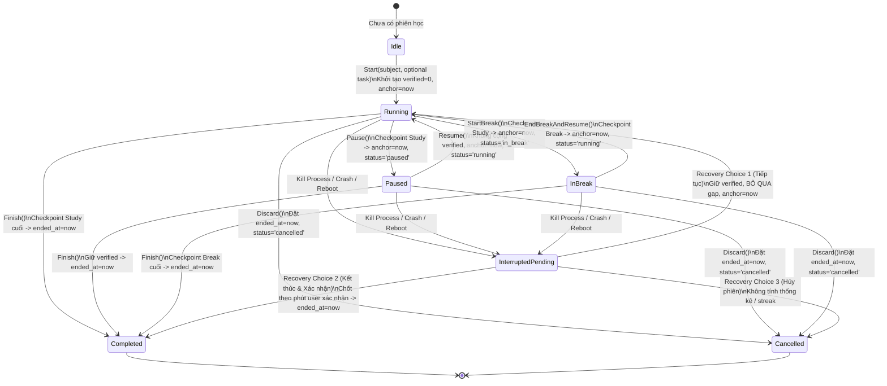

# EXAMPILOT – G8.8.1: REVISE ARCHITECTURE DESIGN & CLOSE CRITICAL GAPS

> **Mã tài liệu:** `g8_8_1_architecture_decisions_study_experience.md`  
> **Phiên bản hiệu chỉnh:** G8.8.4 (Final Product Decision Confirmation Applied)  
> **Cơ sở rà soát:** Tài liệu G8.8, kiểm tra chéo G8.8.2, quy tắc sản phẩm G8.8.3, chốt quyết định G8.8.4 và mã nguồn ExamPilot v1.0.0+1 (SQLite Schema v6, Backup Format v1)  
> **Loại hình:** Architecture Decision Record (ADR) & Technical Specification (DESIGN ONLY – Chưa triển khai mã nguồn)  
> **Mục tiêu:** Tài liệu kiến trúc chuẩn cuối cùng đã khóa 100% quyết định sản phẩm trước khi triển khai Phase 1.

---

## MỤC LỤC
1. [Các quyết định cố định (Immutable Decisions)](#1-các-quyết-định-cố-định-immutable-decisions)
2. [SQL Schema Version 7 hoàn chỉnh (`study_sessions` & `user_profile`)](#2-sql-schema-version-7-hoàn-chỉnh-study_sessions--user_profile)
3. [Sơ đồ trạng thái & Mô hình Tính thời gian Study Timer (Đã hiệu chỉnh G8.8.2)](#3-sơ-đồ-trạng-thái--mô-hình-tính-thời-gian-study-timer-đã-hiệu-chỉnh-g882)
4. [Quy trình Phục hồi Phiên gián đoạn (Recovery State Machine)](#4-quy-trình-phục-hồi-phiên-gián-đoạn-recovery-state-machine)
5. [Sơ đồ trạng thái Alarm (Alarm State Machine – Nhất quán D2)](#5-sơ-đồ-trạng-thái-alarm-alarm-state-machine--nhất-quán-d2)
6. [Quy tắc thống nhất `study_date` và Chuẩn Timestamp](#6-quy-tắc-thống-nhất-study_date-và-chuẩn-timestamp)
7. [Phân tích Tính khả thi Notification, Alarm & Channel trên Android](#7-phân-tích-tính-khả-thi-notification-alarm--channel-trên-android)
8. [Thiết kế Danh sách Âm thanh & Chuyển đổi Channel an toàn](#8-thiết-kế-danh-sách-âm-thanh--chuyển-đổi-channel-an-toàn)
9. [Quy tắc Thống kê & Bảo toàn Thời gian Thủ công/Timer (Zero Double-Counting)](#9-quy-tắc-thống-kê--bảo-toàn-thời-gian-thủ-côngtimer-zero-double-counting)
10. [Thiết kế Backup Format Version 2 & Pipeline Validation 7 bước](#10-thiết-kế-backup-format-version-2--pipeline-validation-7-bước)
11. [Kiến trúc Web Storage cho Phiên học (`WebSessionStorage`)](#11-kiến-trúc-web-storage-cho-phiên-học-websessionstorage)
12. [Tích hợp Smart Timetable G9.0 & Đóng toàn bộ điểm yếu G8.8](#12-tích-hợp-smart-timetable-g90--đóng-toàn-bộ-điểm-yếu-g88)
13. [Lộ trình Triển khai Kỹ thuật Cập nhật (Updated Roadmap)](#13-lộ-trình-triển-khai-kỹ-thuật-cập-nhật-updated-roadmap)
14. [Bảng Rủi ro & Tiêu chí Nghiệm thu Tổng thể](#14-bảng-rủi-ro--tiêu-chí-nghiệm-thu-tổng-thể)

---

## 1. CÁC QUYẾT ĐỊNH CỐ ĐỊNH (IMMUTABLE DECISIONS)

Sáu quyết định cốt lõi dưới đây đã được chốt ở G8.8.1–G8.8.3 và là nguyên tắc bất biến cho toàn bộ thiết kế kỹ thuật:

| STT | Quyết định cố định | Ý nghĩa kiến trúc bắt buộc |
| :---: | :--- | :--- |
| **D1** | **Study Timer hỗ trợ cả học theo môn học và học theo công việc** | Phiên học (`study_sessions`) bắt buộc phải gắn với `subject_id` (hoặc snapshot tên môn nếu môn bị xóa), nhưng trường `task_id` phải là **nullable**. |
| **D2** | **Báo thức phát/lặp âm thanh cho đến khi người dùng Tắt hoặc Nhắc lại** | Trạng thái `Ringing` chỉ dừng khi người dùng bấm **Tắt (`Dismiss`)**, **Nhắc lại (`Snooze`)**, hoặc **Vào học ngay (`Start`)**. Không có timeout tự động chuyển `Ringing` sang `Dismissed`. |
| **D3** | **Khi phát hiện phiên học bị gián đoạn, bắt buộc hỏi xác nhận trước khi ghi nhận thời gian chưa xác minh** | Tuyệt đối cấm tự ý lấy `now - started_at` hoặc giữ `Stopwatch` RAM sau khi app bị tắt đột ngột/kill/reboot để ghi nhận thành giờ học. Mọi khoảng thời gian app đóng không kiểm soát được phải qua bước xác nhận của người dùng. |
| **D4** | **Study Streak yêu cầu tối thiểu 15 phút (900 giây) học thực tế đã xác nhận/ngày** | Tick hoàn thành task **KHÔNG** tự động tăng Streak. Chỉ tính thời gian học (`verified_study_seconds` của phiên `completed`), cộng dồn nhiều phiên trong cùng ngày `study_date`, tối đa +1 Streak/ngày. Học ngoài lịch/trước lịch AI vẫn được tính bình thường. |
| **D5** | **Phân tách tuyệt đối 3 loại dữ liệu: Study Tasks, Scheduled Sessions và Actual Study Sessions** | Một lịch dự kiến/AI đề xuất không đồng nghĩa đã học; một phiên thực tế không bắt buộc gắn với lịch đề xuất; một task hoàn thành không đồng nghĩa đã học đủ thời gian. |
| **D6** | **Lịch AI chỉ là đề xuất & Smart Rescheduling bảo toàn lịch sử/deadline** | Người dùng phải duyệt trước khi lưu lịch AI/lịch bù; không tự xóa hoặc đè lịch user đã duyệt; hủy lịch chỉ bù phần thời lượng còn thiếu; không tự ý dời `deadline` của task. |

---

## 2. SQL SCHEMA VERSION 7 HOÀN CHỈNH (`study_sessions` & `user_profile`)

### 2.1. Các nguyên tắc thiết kế bắt buộc
1. **Không dùng `ON DELETE CASCADE`:** Tránh xóa nhầm toàn bộ lịch sử giờ học khi xóa môn học hoặc công việc. Sử dụng **`ON DELETE SET NULL`** kết hợp lưu Snapshot tên/màu môn học và tên công việc.
2. **`ended_at` nullable:** Phiên đang `running`, `paused`, `in_break`, hoặc `interrupted_pending` chưa kết thúc nên `ended_at` là `NULL`.
3. **`subject_id` và `scheduled_session_id` nullable:** Cho phép giữ nguyên lịch sử phiên học khi môn học gốc bị xóa (`subject_id = NULL`), và cho phép học tự do không gắn với lịch đề xuất (`scheduled_session_id = NULL`).
4. **`study_date` NOT NULL có ngữ nghĩa rõ ràng:** Gán ngay lúc `Start` (theo ngày lịch địa phương tại `started_at`) để cột không bao giờ rỗng và nhất quán trong mọi truy vấn.

### 2.2. Lệnh SQL hoàn chỉnh cho Schema Version 7

```sql
-- ============================================================================
-- 1. BẢNG MỚI: study_sessions (Phiên học tập thực tế)
-- ============================================================================
CREATE TABLE IF NOT EXISTS study_sessions (
    id TEXT PRIMARY KEY,
    
    -- Liên kết môn học: NULLABLE để giữ lại lịch sử nếu môn học gốc bị xóa
    subject_id TEXT,
    -- Tên và màu môn học tại thời điểm học (bảo toàn hiển thị ngay cả khi môn bị xóa)
    subject_name_snapshot TEXT NOT NULL,
    subject_color_snapshot INTEGER,
    
    -- Liên kết công việc: NULLABLE (vì hỗ trợ học tự do theo môn học hoặc task bị xóa)
    task_id TEXT,
    -- Tên công việc tại thời điểm học (nullable nếu học tự do theo môn)
    task_title_snapshot TEXT,
    
    -- Liên kết tới buổi học dự kiến (G9.0): NULLABLE (vì học ngoài lịch/học trước vẫn hợp lệ)
    scheduled_session_id TEXT,
    
    -- Chuẩn Timestamp thống nhất: ISO-8601 UTC (YYYY-MM-DDTHH:mm:ss.sssZ)
    started_at TEXT NOT NULL,
    ended_at TEXT,                         -- NULLABLE: Chỉ có giá trị khi 'completed' hoặc 'cancelled'
    last_heartbeat_at TEXT NOT NULL,       -- Mốc neo Checkpoint khớp 1-1 với thời gian đã chốt sổ
    last_state_changed_at TEXT NOT NULL,   -- Dấu thời gian lịch sử chuyển pha gần nhất (Start/Pause/Resume/Break)
    
    -- Ngày học chuẩn hóa theo giờ địa phương lúc bắt đầu phiên (YYYY-MM-DD)
    study_date TEXT NOT NULL,
    
    -- Thời lượng ĐÃ CHỐT SỔ (giây) tính đến đúng mốc last_heartbeat_at
    verified_study_seconds INTEGER NOT NULL DEFAULT 0 CHECK (verified_study_seconds >= 0),
    accumulated_break_seconds INTEGER NOT NULL DEFAULT 0 CHECK (accumulated_break_seconds >= 0),
    
    -- Trạng thái chuẩn hóa theo State Machine
    status TEXT NOT NULL CHECK (
        status IN (
            'running',             -- Đang đếm giờ học
            'paused',              -- Đang tạm dừng
            'in_break',            -- Đang trong thời gian nghỉ giải lao
            'interrupted_pending', -- Bị đóng đột ngột, ĐANG CHỜ người dùng xác nhận
            'completed',           -- Đã xác nhận hoàn thành hợp lệ
            'cancelled'            -- Đã hủy bỏ (không tính thống kê/streak)
        )
    ),
    
    -- Cấu hình chu kỳ phiên tại thời điểm học
    session_mode TEXT NOT NULL DEFAULT 'stopwatch', -- 'stopwatch', 'pomodoro_25_5', 'deep_50_10', 'long_90_15', 'custom'
    planned_study_minutes INTEGER DEFAULT 0,
    planned_break_minutes INTEGER DEFAULT 0,
    
    -- Ghi chú của phiên học
    notes TEXT NOT NULL DEFAULT '',
    
    -- Khóa ngoại bảo toàn lịch sử (CẤM ON DELETE CASCADE)
    FOREIGN KEY (subject_id) REFERENCES subjects(id) ON DELETE SET NULL,
    FOREIGN KEY (task_id) REFERENCES study_tasks(id) ON DELETE SET NULL
);

CREATE INDEX IF NOT EXISTS idx_sessions_status ON study_sessions(status);
CREATE INDEX IF NOT EXISTS idx_sessions_study_date ON study_sessions(study_date);
CREATE INDEX IF NOT EXISTS idx_sessions_subject_id ON study_sessions(subject_id);
CREATE INDEX IF NOT EXISTS idx_sessions_task_id ON study_sessions(task_id);
CREATE INDEX IF NOT EXISTS idx_sessions_started_at ON study_sessions(started_at);

-- ============================================================================
-- 2. MỞ RỘNG BẢNG user_profile: Cài đặt Âm thanh, Nhắc nhở, Chu kỳ nghỉ & Giới hạn ngày
-- ============================================================================
ALTER TABLE user_profile ADD COLUMN alarm_sound_id TEXT NOT NULL DEFAULT 'alarm_dawn';
ALTER TABLE user_profile ADD COLUMN break_sound_id TEXT NOT NULL DEFAULT 'break_windchime';
ALTER TABLE user_profile ADD COLUMN pre_reminder_minutes INTEGER NOT NULL DEFAULT 10;
ALTER TABLE user_profile ADD COLUMN break_preset_id TEXT NOT NULL DEFAULT 'pomodoro_25_5';
ALTER TABLE user_profile ADD COLUMN custom_study_minutes INTEGER NOT NULL DEFAULT 25;
ALTER TABLE user_profile ADD COLUMN custom_break_minutes INTEGER NOT NULL DEFAULT 5;
ALTER TABLE user_profile ADD COLUMN auto_break_reminder INTEGER NOT NULL DEFAULT 1;
ALTER TABLE user_profile ADD COLUMN notify_pre_study INTEGER NOT NULL DEFAULT 1;
ALTER TABLE user_profile ADD COLUMN notify_alarm_on_time INTEGER NOT NULL DEFAULT 1;
ALTER TABLE user_profile ADD COLUMN notify_session_start INTEGER NOT NULL DEFAULT 1;
ALTER TABLE user_profile ADD COLUMN notify_break_start INTEGER NOT NULL DEFAULT 1;
ALTER TABLE user_profile ADD COLUMN notify_break_end INTEGER NOT NULL DEFAULT 1;
ALTER TABLE user_profile ADD COLUMN daily_study_limit_minutes INTEGER NOT NULL DEFAULT 240; -- Giới hạn giờ tự học/ngày cho Smart Rescheduling G9.0
```

### 2.3. Lưu ý triển khai Migration `onConfigure` & `_onUpgrade`
- Bắt buộc bật `PRAGMA foreign_keys = ON;` trong callback `onConfigure(Database db)` của `openDatabase` thì các ràng buộc `ON DELETE SET NULL` mới thực sự có hiệu lực trong SQLite Android.
- Khi xóa môn học có tùy chọn chuyển giao sang môn mới (theo luồng G8.4), thực hiện `UPDATE study_sessions SET subject_id = ? WHERE subject_id = ?` trước khi xóa môn cũ (có thể chọn giữ hoặc cập nhật snapshot tùy thuộc chính sách đồng nhất lịch sử; khuyến nghị giữ nguyên `subject_name_snapshot` tại thời điểm học hoặc ghi chú đã chuyển để đảm bảo tính xác thực lịch sử). Nếu xóa không chuyển giao (môn không có task), `ON DELETE SET NULL` sẽ giữ nguyên `study_sessions` với `subject_id = NULL` và giữ tên gốc ở `subject_name_snapshot`.

---

## 3. SƠ ĐỒ TRẠNG THÁI & MÔ HÌNH TÍNH THỜI GIAN STUDY TIMER (ĐÃ HIỆU CHỈNH G8.8.2)

### 3.1. Sơ đồ trạng thái Timer



### 3.2. Quy ước duy nhất chống cộng trùng Heartbeat (Checkpoint-Anchor Model)
Để sửa dứt điểm lỗi cộng trùng khi Heartbeat cập nhật `verified_study_seconds` mà công thức hiển thị vẫn lấy hiệu từ `last_state_changed_at` cũ, hệ thống áp dụng quy ước duy nhất:

1. **`last_heartbeat_at` đóng vai trò là Mốc neo Checkpoint duy nhất (Single Checkpoint Anchor)** khớp 1-1 với giá trị `verified_study_seconds` (khi `running`) và `accumulated_break_seconds` (khi `in_break`).
2. **`last_state_changed_at`** chỉ dùng làm dấu mốc lịch sử đánh dấu lần chuyển pha trạng thái gần nhất, **KHÔNG bao giờ tham gia vào phép tính thời gian hiển thị hay cộng dồn**.
3. **Quy tắc Cập nhật Nguyên tử (Atomic Checkpoint Update):**
   - Tại thời điểm thực hiện Heartbeat (mỗi 15s), hoặc chuyển Background, hoặc chuyển trạng thái lúc $t_{\text{now}}$:
     - **Nếu đang `running`:**
       $$\Delta_{\text{sec}} = \max(0, (t_{\text{now}} - t_{\text{last\_heartbeat}}).\text{inSeconds})$$
       $$\text{verified\_study\_seconds}_{\text{new}} = \text{verified\_study\_seconds}_{\text{old}} + \Delta_{\text{sec}}$$
       $$t_{\text{last\_heartbeat, new}} = t_{\text{last\_heartbeat, old}} + \text{Duration}(\text{seconds}: \Delta_{\text{sec}})$$
       *(Lưu ý: Khi Heartbeat định kỳ trong trạng thái `running`, cộng đúng phần nguyên giây $\Delta_{\text{sec}}$ vào mốc neo cũ giúp bảo toàn phần lẻ mili-giây chưa tròn 1 giây để không bị mất dần 0.4–0.9s sau mỗi 15 giây).*
     - **Nếu đang `in_break`:**
       $$\Delta_{\text{sec}} = \max(0, (t_{\text{now}} - t_{\text{last\_heartbeat}}).\text{inSeconds})$$
       $$\text{accumulated\_break\_seconds}_{\text{new}} = \text{accumulated\_break\_seconds}_{\text{old}} + \Delta_{\text{sec}}$$
       $$t_{\text{last\_heartbeat, new}} = t_{\text{last\_heartbeat, old}} + \text{Duration}(\text{seconds}: \Delta_{\text{sec}})$$
     - **Khi chuyển sang pha mới (`Pause`, `Resume`, `StartBreak`, `EndBreak`):**
       - Trước tiên, chạy Checkpoint chốt pha cũ (nếu vừa rời `running` hoặc `in_break`).
       - Sau đó mới đặt `status` mới và gán đồng bộ `last_state_changed_at = t_now` VÀ `last_heartbeat_at = t_now`.

### 3.3. Công thức hiển thị chính thức cho từng trạng thái
Tại bất kỳ thời điểm hiện tại $t_{\text{now}}$ nào khi app đang chạy:
- **Trạng thái `Running`:**
  $$\text{displayedStudySeconds} = \text{verified\_study\_seconds} + \max(0, (t_{\text{now}} - \text{last\_heartbeat\_at}).\text{inSeconds})$$
  $$\text{displayedBreakSeconds} = \text{accumulated\_break\_seconds}$$
- **Trạng thái `Paused`:**
  $$\text{displayedStudySeconds} = \text{verified\_study\_seconds}$$
  $$\text{displayedBreakSeconds} = \text{accumulated\_break\_seconds}$$
- **Trạng thái `InBreak`:**
  $$\text{displayedStudySeconds} = \text{verified\_study\_seconds}$$
  $$\text{displayedBreakSeconds} = \text{accumulated\_break\_seconds} + \max(0, (t_{\text{now}} - \text{last\_heartbeat\_at}).\text{inSeconds})$$

### 3.4. Chứng minh bằng ví dụ số cụ thể (Zero Double-Counting Proof)
Giả sử phiên học bắt đầu lúc `08:00:00.000Z`:
1. **`08:00:00.000Z` (Start):** `status = 'running'`, `verified = 0`, `last_heartbeat_at = 08:00:00.000Z`, `last_state_changed_at = 08:00:00.000Z`.
2. **`08:00:10.500Z` (Hiển thị trước Heartbeat 1):**
   `displayedStudy = 0 + (08:00:10.500Z - 08:00:00.000Z).inSeconds = 10s`.
3. **`08:00:15.400Z` (Heartbeat 1 kích hoạt):**
   - $\Delta = (08:00:15.400 - 08:00:00.000).\text{inSeconds} = 15\text{s}$.
   - `verified = 0 + 15 = 15`.
   - `last_heartbeat_at = 08:00:00.000Z + 15s = 08:00:15.000Z` (giữ nguyên phần lẻ `.400s` chưa tròn giây).
4. **`08:00:20.200Z` (Hiển thị sau Heartbeat 1 — Chứng minh không cộng trùng):**
   `displayedStudy = 15 + (08:00:20.200Z - 08:00:15.000Z).inSeconds = 15 + 5 = 20s`. *(Chính xác tuyệt đối với 20.2s thực tế, không bị thành `15 + 20 = 35s`!)*
5. **`08:00:35.000Z` (Bấm Pause):**
   - Chốt pha Running: $\Delta = (08:00:35.000 - 08:00:15.000).\text{inSeconds} = 20\text{s}$.
   - `verified = 15 + 20 = 35s`.
   - Chuyển pha: `status = 'paused'`, `last_heartbeat_at = 08:00:35.000Z`, `last_state_changed_at = 08:00:35.000Z`.
   - Ngồi nghỉ uống nước 5 phút đến `08:05:35.000Z`: Vì `status == 'paused'`, `displayedStudy = verified = 35s`.
6. **`08:05:35.000Z` (Bấm Resume):**
   - Chuyển pha: `status = 'running'`, `last_heartbeat_at = 08:05:35.000Z`, `last_state_changed_at = 08:05:35.000Z`. `verified` giữ nguyên `35s`.
   - Đến `08:05:45.000Z`: `displayedStudy = 35 + (08:05:45 - 08:05:35) = 45s`.

### 3.5. Xử lý Background, Kill & Reboot
- **App chuyển Background (`AppLifecycleState.paused`) nhưng tiến trình KHÔNG bị OS kill:**
  - Khi nhận `AppLifecycleState.paused`: Thực thi ngay 1 nhịp Checkpoint xuống DB/LocalStorage.
  - Khi quay lại `AppLifecycleState.resumed`: Vì tiến trình chưa hề bị hủy, bộ điều khiển tính lại delta từ `last_heartbeat_at` đến hiện tại (`now`), cập nhật checkpoint ngay (kiểm chứng thêm bằng `Stopwatch` trong RAM để phát hiện đổi giờ hệ thống). Đồng hồ không bị trôi dù hệ điều hành tạm dừng UI timer.
- **App bị OS Kill / Force-stop / Reboot (tiến trình bị hủy):**
  - Toàn bộ biến RAM (bao gồm `Stopwatch` nếu có) bị mất hoàn toàn. **Không dùng `Stopwatch` RAM để phục hồi.**
  - Khi mở lại app: Đọc dòng dữ liệu trong SQLite (`status IN ('running', 'paused', 'in_break', 'interrupted_pending')`).
  - Giá trị `verified_study_seconds` trong SQLite chính là phần thời gian tin cậy cuối cùng tính đến `last_heartbeat_at`. Phần chênh lệch `(now - last_heartbeat_at)` là **unverified gap**, bắt buộc đưa vào quy trình Recovery 3 lựa chọn (Mục 4).

---

## 4. QUY TRÌNH PHỤC HỒI PHIÊN GIÁN ĐOẠN (RECOVERY STATE MACHINE)

```mermaid
flowchart TD
    START[Mở ứng dụng] --> QUERY[Tìm session chưa kết thúc:\nrunning | paused | in_break | interrupted_pending]
    QUERY --> FOUND{Tìm thấy?}
    FOUND -->|Không| OK[Chạy bình thường]
    FOUND -->|Có| CHECK[Kiểm tra started_at, last_heartbeat_at,\nclock skew & stale > 8 giờ]

    CHECK --> CORRUPT{Dữ liệu lỗi nặng\nhoặc thiếu trường?}
    CORRUPT -->|Có| ISOLATE[Đánh dấu cancelled / Cô lập bản ghi lỗi\nThông báo an toàn, không crash app]
    CORRUPT -->|Không| SET_PENDING[Chuyển DB status = 'interrupted_pending'\nTính verified_minutes & unverified_gap]

    SET_PENDING --> MODAL[Hiển thị Recovery Dialog BẮT BUỘC\nbarrierDismissible: false]
    
    MODAL --> C1["1. Tiếp tục học từ lúc mở lại"]
    MODAL --> C2["2. Kết thúc & Xác nhận thời lượng hợp lệ"]
    MODAL --> C3["3. Hủy phiên học này"]

    C1 --> A1["Giữ verified_study_seconds\nBỎ QUA toàn bộ unverified_gap\nstatus='running', last_heartbeat_at=now"]
    C2 --> A2["Người dùng chọn/xác nhận số phút\n(Mặc định: verified_minutes)\nstatus='completed', ended_at=now"]
    C3 --> A3["status='cancelled', ended_at=now\n0 phút vào Thống kê, 0 vào Streak"]
```

- **Phân định rạch ròi thời gian trong Recovery Dialog:**
  - **Thời gian đã xác nhận (`verified`):** Hiển thị rõ: *"Thời gian đã ghi nhận chắc chắn trước khi gián đoạn: X phút"*.
  - **Thời gian chưa xác minh (`unverified_gap`):** Hiển thị riêng: *"Thời gian trôi qua khi ứng dụng đóng: Y phút (chưa được tính)"*.
  - Nếu chọn **Tiếp tục học**: Bắt buộc loại bỏ `unverified_gap`, chỉ học nối tiếp từ mốc `verified`.
  - Nếu chọn **Kết thúc & Xác nhận**: Gợi ý mặc định là `X phút` (chỉ phần đã xác minh). Nếu thực tế sinh viên vẫn ngồi học trên sách vở lúc điện thoại sập nguồn/tắt app, sinh viên được phép kéo thanh trượt hoặc nhập thêm một phần thời gian trong biên hợp lệ `[verified, min(verified + gap, 720 phút)]` để xác nhận chính thức, sau đó mới chuyển sang `completed`.
  - Nếu mở lại khi đang ở pha **`in_break`** hoặc **`paused`**: Thời gian học đã chốt ở `verified_study_seconds`, `unverified_gap` đối với giờ học bằng `0` — hộp thoại thông báo rõ *"Gián đoạn khi đang nghỉ giải lao / tạm dừng"* và vẫn cung cấp đủ 3 lựa chọn chuẩn.

---

## 5. SƠ ĐỒ TRẠNG THÁI ALARM (ALARM STATE MACHINE – NHẤT QUÁN D2)

### 5.1. Sơ đồ State Machine chính thức (Đã loại bỏ Timeout tự động Dismiss)

```mermaid
stateDiagram-v2
    [*] --> Scheduled: Lên lịch One-shot hoặc Định kỳ

    Scheduled --> Cancelled: Sửa lịch / Xóa lịch /\nTắt thông báo tổng
    Scheduled --> Ringing: Đến giờ AlarmManager / Browser kích hoạt

    Ringing --> Snoozed: Người dùng bấm\n[Nhắc lại] (Chỉ khi snooze_count == 0)
    Ringing --> Dismissed: Người dùng bấm\n[Tắt báo thức]
    Ringing --> Started: Người dùng bấm\n[Vào học ngay]

    Note right of Ringing: TUYỆT ĐỐI KHÔNG tự chuyển sang Dismissed.\nPhát lặp liên tục cho tới khi người dùng thao tác\n(hoặc chịu tác động giới hạn phần cứng/OEM từ ngoài app).

    Snoozed --> Scheduled: Đặt 1 One-shot Alarm (+5 phút)\nvới snooze_count = 1
    Note right of Snoozed: Khi reo lại với snooze_count == 1,\nnút [Nhắc lại] bị ẩn/vô hiệu hóa.

    Started --> [*]: Dừng chuông -> Mở Study Timer
    Dismissed --> CheckType{Loại báo thức?}
    CheckType -->|One-shot| EndOneShot[*]
    CheckType -->|Định kỳ G9.0| ResolveNext[TimetableScheduleResolver:\nTính ca tiếp theo có xét chẵn/lẻ, ngày nghỉ, ngoại lệ]
    ResolveNext --> Scheduled
    Cancelled --> [*]
```

### 5.2. Quy tắc chi tiết
1. **Không có Auto-Timeout Dismiss:** Theo Quyết định D2, code không đặt `Timer` tắt chuông sau 5 hay 10 phút. Trạng thái `Ringing` chỉ kết thúc khi nhận thao tác `Dismiss`, `Snooze`, hoặc `Start`.
2. **Nếu người dùng không tương tác:** State Machine giữ nguyên `Ringing`. Chuông tiếp tục yêu cầu phát lặp. Nếu thiết bị OEM cưỡng chế ngắt âm thanh/service ở tầng hệ điều hành hoặc người dùng tắt màn hình làm mất Audio Focus mà chưa bấm Tắt, trạng thái logic vẫn ghi nhận phiên báo thức đó là *Unacknowledged (Chưa xác nhận)* khi mở app lại, **tuyệt đối không tự đánh dấu là `Dismissed`**.
3. **Snooze tối đa 1 lần cho mỗi ca gốc:** Dùng biến `snooze_count` (mặc định `0`). Lần reo đầu tiên cho phép bấm `Snooze` (+5 phút, tăng `snooze_count = 1`). Lần reo từ Snooze chỉ hiển thị 2 nút: **`Vào học ngay`** và **`Tắt báo thức`**.
4. **Phân biệt Báo thức Một lần vs Định kỳ & Tích hợp G9.0:**
   - **Báo thức Một lần (One-shot):** Dành cho Deadline Task, Hết giờ nghỉ giải lao, Snooze. Sau `Dismissed` hoặc `Started` thì kết thúc.
   - **Báo thức Định kỳ (Recurring):** Gắn với ca học trong Thời khóa biểu (G9.0). Khi một ca kết thúc, **cấm cộng cố định `+7 ngày`**. Hệ thống bắt buộc truy vấn `TimetableScheduleResolver` để tính ngày kế tiếp thỏa mãn: (a) Tuần chẵn/lẻ/tất cả, (b) Không rơi vào kỳ nghỉ/ngày lễ, (c) Không có ngoại lệ hủy buổi học, (d) Áp dụng giờ mới nếu ca học bị đổi lịch.
5. **Chống trùng Alarm:** Mỗi ca học sử dụng `alarmId` tất định (hash 31-bit theo `entityId + slotKey`), lưu trong bảng/danh sách `active_alarm_ids`. Khi sửa hoặc xóa lịch, hệ thống hủy toàn bộ `alarmId` cũ trước khi tạo lịch mới.

---

## 6. QUY TẮC THỐNG NHẤT `study_date` VÀ CHUẨN TIMESTAMP

| Quy tắc | Quyết định kỹ thuật chính thức | Giải thích & Lý do |
| :--- | :--- | :--- |
| **1. Chuẩn Timestamp lưu trữ** | **Thống nhất 1 chuẩn duy nhất: ISO-8601 UTC (`YYYY-MM-DDTHH:mm:ss.sssZ`)** cho cả SQLite (`study_sessions`) và Backup JSON v2 (`createdAt`, `started_at`, `ended_at`, `last_heartbeat_at`, `last_state_changed_at`). | 1) Tương thích native Dart `.toUtc().toIso8601String()` trên mọi nền tảng.<br>2) Sắp xếp chuỗi `ORDER BY started_at` trong SQLite chính xác 100% bất kể đổi múi giờ.<br>3) Khi hiển thị lên UI, gọi `.toLocal()` để đổi sang giờ địa phương của thiết bị hiện tại. *(Với chuỗi v1 cũ chưa có `Z`, `DateTime.tryParse` đọc như local để tương thích ngược).* |
| **2. Thời điểm gán `study_date`** | **Gán NGAY LÚC TẠO PHIÊN (`Start`)** theo ngày lịch địa phương của `started_at`:<br>`study_date = StudyStreak.formatDateKey(startedAt.toLocal())` | Đảm bảo ràng buộc `study_date TEXT NOT NULL` luôn hợp lệ ngay từ lúc `INSERT` phiên đang chạy. |
| **3. Phiên học qua nửa đêm** | Tính vào **ngày bắt đầu học (`study_date` ban đầu tại `started_at`)**. | Nếu sinh viên ôn bài liên tục từ `23:30 ngày 11/11` đến `00:15 ngày 12/11`, toàn bộ công sức tối đó được ghi nhận vào `2026-11-11` (ngày học thực sự của buổi tối hôm đó). |
| **4. Recovery sau Reboot / Kill** | **Giữ nguyên `study_date` ban đầu** nếu người dùng chọn Tiếp tục hoặc Xác nhận phần đã học của phiên cũ. | Đảm bảo thời gian đã học ở `verified_study_seconds` (tích lũy trước khi reboot) nằm đúng ngày thực tế diễn ra nó. *(Với phiên bỏ quên nhiều ngày, dialog Recovery cảnh báo rõ ngày bắt đầu gốc để user cân nhắc bấm Hủy hoặc Xác nhận rồi tạo phiên mới cho hôm nay).* |

### Ví dụ dữ liệu chuẩn thực tế (Sinh viên ở Việt Nam `UTC+07:00`)
- Sinh viên bắt đầu học lúc **23:30:00 tối ngày 11/11/2026 (giờ Việt Nam `+07:00`)**:
  - `started_at`: `"2026-11-11T16:30:00.000Z"` *(tương đương 23:30:00+07:00)*
  - `study_date`: `"2026-11-11"`
- Sinh viên hoàn thành phiên học lúc **00:15:00 sáng ngày 12/11/2026 (giờ Việt Nam `+07:00`)**:
  - `ended_at`: `"2026-11-11T17:15:00.000Z"` *(tương đương 00:15:00+07:00 ngày 12/11)*
  - `last_heartbeat_at`: `"2026-11-11T17:15:00.000Z"`
  - `verified_study_seconds`: `2700` (45 phút)
  - `study_date`: **`"2026-11-11"`** (Giữ đúng ngày buổi học bắt đầu).

---

## 7. PHÂN TÍCH TÍNH KHẢ THI NOTIFICATION, ALARM & CHANNEL TRÊN ANDROID

Thay vì gộp chung, tài liệu phân tách nghiêm ngặt **4 năng lực độc lập** và nêu rõ điều kiện bảo đảm thực tế trên hệ sinh thái Android:

| Năng lực | Thành phần Android sử dụng | Phần AOSP hỗ trợ (Khi đủ quyền) | Giới hạn OEM / Người dùng (KHÔNG thể bảo đảm tuyệt đối) |
| :--- | :--- | :--- | :--- |
| **1. Lên lịch (Scheduling)** | `SCHEDULE_EXACT_ALARM` (Android 12+). *(Tránh `USE_EXACT_ALARM` để tuân thủ Google Play Policy).* | Khi có quyền, `AlarmManager` nhận đăng ký thời điểm chính xác. | Android 14+ tắt sẵn `SCHEDULE_EXACT_ALARM` ở một số cài đặt mới; người dùng có thể thu hồi quyền bất cứ lúc nào -> Cần kiểm tra `canScheduleExactAlarms()` trước mỗi lần đặt lịch. |
| **2. Đánh thức thiết bị (CPU Wakeup)** | `AlarmManager.setAlarmClock()` | Ở cấp Android chuẩn (Pixel/AOSP), `setAlarmClock()` có ưu tiên cao nhất để xuyên Doze Mode. | Các ROM tùy biến sâu (Xiaomi MIUI/HyperOS, Oppo ColorOS, Vivo, Huawei) vẫn có thể chặn hoặc trì hoãn BroadcastReceiver nếu người dùng chưa bật **Tự khởi chạy (Autostart)** hoặc đặt app vào danh sách ngủ sâu. **Không thể cam kết 100% trên mọi OEM.** |
| **3. Hiển thị Notification** | `POST_NOTIFICATIONS` (Android 13+) + `USE_FULL_SCREEN_INTENT` (Android 14+) | Hiển thị Heads-up / Lock-screen UI nếu được cấp quyền. | Nếu từ chối `POST_NOTIFICATIONS`, không hiện thông báo. Android 14+ mặc định tắt `USE_FULL_SCREEN_INTENT` cho app không phải Call/Alarm thuần -> có thể chỉ hiện thông báo thường trên màn hình khóa chứ không tự bung toàn màn hình. |
| **4. Phát âm thanh lặp liên tục** | `ForegroundService` (`MEDIA_PLAYBACK` / `SPECIAL_USE`) + `AudioPlayer` (luồng `STREAM_ALARM`) | Chạy ổn định trên Android chuẩn nếu không bị thu hồi Audio Focus. | **KHÔNG bảo đảm tuyệt đối trên mọi OEM:** Âm thanh có thể không phát hoặc bị ngắt nếu (a) Âm lượng báo thức của máy bị vặn về 0, (b) Máy bật DND mức Total Silence, (c) OEM kill Foreground Service ngầm do pin yếu/nhiệt độ, (d) Điện thoại có cuộc gọi đến chiếm Audio Focus. |
| **5. Tồn tại qua Reboot / Force-stop** | `RECEIVE_BOOT_COMPLETED` | BootReceiver chạy lại sau khi người dùng mở khóa máy lần đầu sau reboot. | **Force-stop:** Khi người dùng bấm Force Stop trong Cài đặt Android, **mọi Alarm, Receiver và Service bị xóa sạch** cho tới khi người dùng bấm mở app lại bằng tay (giới hạn tuyệt đối của Android). |

**Kiến trúc Package đề xuất (Design Only – Chưa cài đặt):**
- `flutter_local_notifications` + `timezone`: Quản lý Notification Channels, Action buttons, Scheduled notifications.
- `android_alarm_manager_plus` (hoặc Native Kotlin MethodChannel cho `setAlarmClock`): Đánh thức ở mức OS vượt Doze.
- `audioplayers`: Phát lặp âm thanh chuông qua luồng Audio/Alarm và hỗ trợ nghe thử đa nền tảng.

---

## 8. THIẾT KẾ DANH SÁCH ÂM THANH & CHUYỂN ĐỔI CHANNEL AN TOÀN

### 8.1. Danh sách 6 âm thanh chuẩn + Tùy chọn Im lặng (`none`)
- **Báo thức (Alarm):** `alarm_dawn` (Rạng đông), `alarm_school_bell` (Chuông trường học), `alarm_energetic` (Nhịp điệu sôi động), `none` (Không phát âm thanh).
- **Nhắc nghỉ (Break):** `break_windchime` (Tiếng chuông gió), `break_waterdrop` (Giọt nước), `break_marimba` (Thư giãn), `none` (Không phát âm thanh).
- **Lưu trữ tài nguyên thực tế:** `assets/audio/<id>.mp3` (cho `AudioPlayer` trên Android/Web khi nghe thử và phát lặp báo thức) + `android/app/src/main/res/raw/<id>.ogg` (cho Android Notification Channel của các nhắc nhở ngắn).
- **Xử lý lỗi thiếu/hỏng file audio:** Bọc `try-catch` khi load asset; nếu lỗi, fallback tức thì sang âm báo mặc định của hệ thống hoặc giữ rung/visual popup, không bao giờ để crash luồng báo thức.

### 8.2. Chiến lược quản lý Notification Channel An toàn (Không xóa Channel tùy tiện)
Khắc phục lỗ hổng ở G8.8.1 (xóa channel cũ ngay lập tức làm chết pending notification và mất cài đặt người dùng):
1. **Bộ Channel hữu hạn cố định (Fixed Channel Registry):** Tổng số tùy chọn âm thanh chỉ là 8 (`4 Alarm + 4 Break`), tương ứng với tối đa 8 Notification Channels hữu hạn có ID cố định (`exampilot_alarm_dawn_v1`, `exampilot_alarm_school_bell_v1`, ...). Không sinh channel ID ngẫu nhiên gây rác Settings hệ thống.
2. **Thứ tự chuyển đổi khi người dùng đổi chuông từ A sang B:**
   - **Bước 1:** Gọi `createNotificationChannel(channelB)` — đảm bảo channel B đã sẵn sàng 100% trên hệ điều hành trước khi sử dụng.
   - **Bước 2:** Lập lịch lại (Cancel & Re-schedule) toàn bộ pending notifications của nhóm tương ứng sang `channelB`.
   - **Bước 3:** Kiểm tra `pendingNotificationRequests()` xác nhận không còn lịch nào trỏ về `channelA`.
   - **Bước 4:** **KHÔNG xóa `channelA` ngay lập tức** (hoặc giữ nguyên bộ 8 channels cố định). Việc giữ lại các channel hợp lệ trong tập 8 channels giúp:
     - Tránh tuyệt đối lỗi notification bắn ra bị mất trắng do trỏ vào channel vừa bị xóa.
     - Bảo toàn toàn bộ thiết lập cá nhân hóa của người dùng (như Bypass DND, kiểu rung tùy chỉnh) nếu họ đổi qua lại giữa các tiếng chuông.

---

## 9. QUY TẮC THỐNG KÊ & BẢO TOÀN THỜI GIAN THỦ CÔNG/TIMER (ZERO DOUBLE-COUNTING)

### 9.1. Sửa lỗi quy tắc cũ trong G8.8.1
G8.8.1 trước đây có một lỗ hổng: Nếu Task T1 có sẵn **60 phút thủ công từ trước G8.8**, rồi sau nâng cấp sinh viên dùng Timer học thêm **30 phút**, quy tắc cũ bỏ toàn bộ `actualMinutes` của task có session sẽ làm **MẤT 60 phút lịch sử**.

### 9.2. Kiến trúc Tách sổ độc lập (Disjoint Time Ledgers)
Hệ thống phân định 2 sổ cái thời gian hoàn toàn tách biệt, không ghi đè lẫn nhau:

1. **Sổ cái Timer (`study_sessions`):**
   - Lưu **duy nhất thời gian đo qua Study Timer** (hoặc đã xác nhận qua Recovery).
   - **Quy tắc ghi bất biến:** Khi kết thúc một phiên học của Timer (dù có gắn `taskId` hay không), hệ thống **CHỈ ghi vào bảng `study_sessions`**. **TUYỆT ĐỐI KHÔNG cộng dồn hay ghi đè số phút của Timer vào `study_tasks.actual_minutes` hay `study_activities.actual_minutes`!**
2. **Sổ cái Thủ công & Dữ liệu cũ (`study_activities.actual_minutes` / `study_tasks.actual_minutes`):**
   - Lưu **duy nhất thời gian nhập thủ công** (gồm 100% dữ liệu lịch sử trước G8.8 và thời gian sinh viên tự nhập tay khi hoàn thành công việc mà không dùng Timer).
   - **Không tạo session giả** từ dữ liệu lịch sử cũ.
   - Trong `TaskAssessmentDialog`: Hiển thị tách bạch 2 thông tin:
     - *Thời gian đã đo bằng Đồng hồ (chỉ đọc):* $\sum \text{completed sessions}$ của task đó (VD: 30 phút).
     - *Thời gian tự ghi nhận / trước đây (nhập tay):* `task.actualMinutes` (VD: 60 phút). Khi bấm lưu chỉ cập nhật giá trị thủ công này vào `task.actualMinutes` và `activity.actualMinutes`, không chạm vào `study_sessions`.

### 9.3. Công thức Thống kê chuẩn hóa cuối cùng
$$\text{Tổng phút học trong kỳ} = \underbrace{\sum_{\substack{s \in \text{study\_sessions} \cap \text{Kỳ} \\ s.\text{status} = \text{'completed'}}} \left\lfloor \frac{s.\text{verified\_study\_seconds}}{60} \right\rfloor}_{\text{1. Thời gian thực từ Study Timer (Sessions)}} + \underbrace{\sum_{a \in \text{study\_activities} \cap \text{Kỳ}} a.\text{actualMinutes}}_{\text{2. Thời gian thủ công & Dữ liệu cũ}} + \underbrace{\text{ExtraLegacyAllTime}}_{\text{3. Fallback task cũ thiếu activity}}$$

*Giải thích `ExtraLegacyAllTime`:* Chỉ áp dụng cho kỳ `allTime` với các task hoàn thành từ phiên bản rất cũ/mock test chưa có dòng nào trong `study_activities`, giống logic hiện tại của [`StudyStatisticsCalculator`](file:///c:/Flutter%20PJ/exampilot/lib/models/study_statistics.dart#L176-L185).

- **Study Streak chính thức (G8.8.4 – Chốt Phương án A & Bảo toàn Lịch sử cũ):**
  $$\text{DailyStudySeconds}(d) = \sum_{\substack{s \in \text{study\_sessions} \\ s.\text{study\_date} == d \\ s.\text{status} = \text{'completed'}}} s.\text{verified\_study\_seconds}$$
  $$\text{ActiveStreakDates} = \{ d \mid \text{DailyStudySeconds}(d) \ge 900 \}$$
  - **Phương án A chính thức:** Streak hợp lệ theo quy tắc mới **CHỈ được tính từ `study_sessions` (`completed`)** đạt tổng $\ge 900$ giây (`15 phút`) trong cùng ngày `study_date` địa phương (cộng dồn nhiều phiên trong ngày, tối đa +1 Streak/ngày). **Không** chuyển `study_activities`/`actual_minutes` cũ thành session giả, **không** dùng giờ nhập thủ công để tính Streak, và **không** tạo thêm cơ chế cộng Streak thứ hai.
  - **Bảo toàn lịch sử cũ & Hiển thị chuyển tiếp:** Toàn bộ `study_activities` cũ (và `actual_minutes`) được giữ nguyên vẹn khi nâng cấp hay khôi phục Backup (không xóa ngày cũ). Hệ thống phân tách rạch ròi trên UI: Thẻ Study Streak hiển thị Streak chính thức mới ($\ge 15\text{p}$ Đồng hồ/ngày), đồng thời hiển thị dòng ghi chú chuyển tiếp nếu tồn tại dữ liệu cũ *(VD: "Lịch sử X ngày hoạt động cũ vẫn được bảo toàn nguyên vẹn trong mục Thống kê")*, tránh gây hiểu nhầm mất dữ liệu hoặc nhầm lẫn dữ liệu cũ là đã xác minh bằng Timer.
  - **Quy tắc ngày Streak, DST & Chuyển múi giờ (Rà soát `StudyStreak.parseDateKey()`):**
    - Ngày Streak là ngày lịch địa phương (`YYYY-MM-DD`); `study_date` giữ cố định theo ngày địa phương tại `started_at`.
    - **Cấm lấy chênh lệch mili giây chia cho 24 giờ** (`difference.inDays`) hay trừ `Duration(days: 1)` trên Local `DateTime` (vì ngày DST 23h/25h làm phép chia 24h sai 1 ngày!). Phải sử dụng **Pure Calendar-Day Stepping**: tạo bản ghi lịch `(year, month, day)`, bước lùi/tiến ngày bằng phép tính lịch Gregorian (`previousDay` / `nextDay` dựa theo số ngày của tháng và năm nhuận) và kiểm tra bình đẳng trực tiếp bộ `(year, month, day)`.
    - **Chuyển múi giờ thiết bị:** Khi máy đổi múi giờ, các `study_date` lịch sử đã đóng dấu giữ nguyên (không viết lại); ngày "hôm nay" lấy từ `DateTime.now().toLocal()`. Nhờ bước nhảy Pure Calendar và khóa duy nhất trong `Set<String>`, chuyển múi giờ hay DST không bao giờ tạo ngày Streak giả hoặc nhân đôi ngày.
  - **Cấm tính phiên chưa xác nhận:** Các trạng thái `running`, `paused`, `in_break`, `interrupted_pending`, `cancelled`, thời gian nghỉ (`accumulated_break_seconds`) và việc tick hoàn thành task thông thường tuyệt đối không tăng Streak. Học ngoài lịch / trước lịch AI vẫn tính bình thường nếu qua Timer (`study_sessions`).

### 9.4. 5 Test Case Minh họa & Kiểm chứng Công thức
1. **Test Case 1 – Task chỉ có thời gian thủ công (Dữ liệu cũ trước G8.8):**
   - Task `T1`: `actualMinutes = 60`, `activity = 60 phút`, `sessions = 0`.
   - Kết quả: Timer (`0`) + Thủ công (`60`) = **60 phút**. Bảo toàn 100% lịch sử cũ.
2. **Test Case 2 – Task có nhiều Session trên nhiều ngày (Không nhập tay):**
   - Task `T2`: `activity.actualMinutes = 0`. Có `S1` hôm qua (`1500s = 25p`, `completed`) và `S2` hôm nay (`2400s = 40p`, `completed`).
   - Kết quả: Timer (`25 + 40 = 65`) + Thủ công (`0`) = **65 phút** (Biểu đồ hôm qua 25p, hôm nay 40p). Streak ghi nhận cả 2 ngày.
3. **Test Case 3 – Task có CẢ thời gian thủ công cũ (60p) VÀ Timer mới (30p):**
   - Task `T3`: Có sẵn `actualMinutes = 60` (`activity = 60p`) từ trước G8.8. Nay sinh viên dùng Timer học thêm 30 phút (`S3`: `1800s`, `completed`).
   - Kết quả: Timer (`30`) + Thủ công (`60`) = **90 phút** (Bảo toàn trọn vẹn 60p cũ, cộng chuẩn xác 30p mới, **0 đếm trùng**).
4. **Test Case 4 – Session bị hủy (`cancelled`):**
   - Task `T4`: `S4` có `verified_study_seconds = 900` (15p), `status = 'cancelled'`, `actualMinutes = 0`.
   - Kết quả: `S4` không thỏa điều kiện `status == 'completed'` -> Timer (`0`) + Thủ công (`0`) = **0 phút**, không tăng Study Streak.
5. **Test Case 5 – Session đang chờ Recovery (`interrupted_pending`):**
   - Task `T5`: `S5` bị đóng đột ngột khi đang chạy, `verified_study_seconds = 1200` (20p), `status = 'interrupted_pending'`.
   - Kết quả trước khi user xác nhận: Timer (`0`) + Thủ công (`0`) = **0 phút**, không tăng Study Streak. Chỉ khi user xác nhận qua Recovery Dialog chuyển `status = 'completed'`, 20 phút mới xuất hiện trong Thống kê.

---

## 10. THIẾT KẾ BACKUP FORMAT VERSION 2 & PIPELINE VALIDATION 7 BƯỚC

### 10.1. Cấu trúc Format Version 2 (Thống nhất Timestamp UTC `...Z`)
```json
{
  "app": "ExamPilot",
  "formatVersion": 2,
  "appVersion": "1.1.0",
  "createdAt": "2026-11-12T10:30:00.000Z",
  "metadata": {
    "totalSubjects": 4,
    "totalTasks": 12,
    "totalActivities": 15,
    "totalSessions": 24,
    "hasInterruptedSessions": false
  },
  "data": {
    "profile": { ... },
    "subjects": [ ... ],
    "tasks": [ ... ],
    "activities": [ ... ],
    "sessions": [
      {
        "id": "sess_1731380000_01",
        "subject_id": "subj_1",
        "subject_name_snapshot": "Toán cao cấp",
        "subject_color_snapshot": 4282080219,
        "task_id": "task_1",
        "task_title_snapshot": "Ôn tập chương 3 Đạo hàm",
        "scheduled_session_id": null,
        "started_at": "2026-11-11T16:30:00.000Z",
        "ended_at": "2026-11-11T17:15:00.000Z",
        "last_heartbeat_at": "2026-11-11T17:15:00.000Z",
        "last_state_changed_at": "2026-11-11T16:30:00.000Z",
        "study_date": "2026-11-11",
        "verified_study_seconds": 2700,
        "accumulated_break_seconds": 300,
        "status": "completed",
        "session_mode": "pomodoro_25_5",
        "planned_study_minutes": 25,
        "planned_break_minutes": 5,
        "notes": "Đã giải xong phần vi phân"
      }
    ]
  },
  "checksum": "8a2f19b4"
}
```
*Lưu ý xuất phiên đang dở:* Khi Export Backup, tất cả phiên `completed` được giữ nguyên. Nếu đang có phiên `running`, `paused`, `in_break`, hoặc `interrupted_pending`, hệ thống xuất nó dưới trạng thái **`interrupted_pending`** (`ended_at: null`), kèm cảnh báo cho người dùng. Phiên `cancelled` được loại khỏi file backup cho nhẹ.

### 10.2. Pipeline Validation & Restore 7 bước nhất quán
1. **Bước 1 – Parse JSON & Kiểm tra Checksum:** Giải mã chuỗi JSON, kiểm tra `app == 'ExamPilot'`, `formatVersion <= 2`, kiểm tra Adler-32 Checksum trên raw `data` map (trước khi chỉnh sửa bất cứ thứ gì trong RAM).
2. **Bước 2 – Kiểm tra Cấu trúc & Kiểu dữ liệu thô:**
   - Bắt buộc `subjects`, `tasks`, `activities` là `List`.
   - Nếu `formatVersion == 1`: cho phép thiếu `sessions` (mặc định `[]`). Nếu `formatVersion == 2`: yêu cầu `sessions` là `List`.
   - Kiểm tra từng item trong `sessions` phải là `Map`: có `id` không rỗng, `subject_name_snapshot` không rỗng, `started_at` parse được thành DateTime hợp lệ, `verified_study_seconds >= 0`, `accumulated_break_seconds >= 0`, và `status` thô phải nằm trong tập hợp hợp lệ: `{'running', 'paused', 'in_break', 'interrupted_pending', 'completed', 'cancelled'}`. (Từ chối ngay nếu gặp status lạ không xác định).
3. **Bước 3 – Chuẩn hóa trạng thái phiên chưa kết thúc (Sanitization trên bản sao RAM):**
   - Bất kỳ session nào có status thô thuộc `{'running', 'paused', 'in_break'}` -> Chuẩn hóa ngay thành **`status = 'interrupted_pending'`** và **`ended_at = null`**.
   - **Tuyệt đối cấm** tự động nâng cấp phiên thành `completed` tại bước này hay bước nào khác!
4. **Bước 4 – Kiểm tra trạng thái cuối cùng & Ràng buộc chéo sau chuẩn hóa:**
   - Xác minh toàn bộ `sessions` lúc này chỉ mang 1 trong 3 trạng thái cuối cùng: **`completed`**, **`interrupted_pending`**, **`cancelled`**.
   - Nếu `status == 'completed'`: bắt buộc `ended_at != null` và `ended_at` parse được hợp lệ (nếu thiếu `ended_at`, từ chối file hỏng).
   - Kiểm tra `study_date` đúng định dạng `YYYY-MM-DD`.
5. **Bước 5 – Kiểm tra liên kết Subject / Task:**
   - Nếu `session.subjectId != null` nhưng không tồn tại trong `data['subjects']`: Gán `subjectId = null`, giữ nguyên `subjectNameSnapshot` để tránh lỗi Foreign Key SQLite và vẫn giữ tên môn lịch sử.
   - Nếu `session.taskId != null` nhưng không tồn tại trong `data['tasks']`: Gán `taskId = null`, giữ nguyên `taskTitleSnapshot`.
6. **Bước 6 – Hiển thị Preview & Cảnh báo:**
   - Đếm riêng `completedSessions` và `interruptedPendingSessions`. Nếu có phiên `interrupted_pending`, hiện hộp cảnh báo màu cam rõ ràng trong `RestorePreviewDialog`.
7. **Bước 7 – Chỉ Restore sau khi người dùng bấm Xác nhận:**
   - Thực thi trong `db.transaction`: Xóa bảng con trước (`study_sessions` -> `study_activities` -> `study_tasks` -> `subjects` -> `user_profile`), Insert bảng cha trước (`subjects` -> `study_tasks` -> `study_activities` -> `study_sessions` -> `user_profile`). Bất kỳ lỗi nào xảy ra đều Rollback toàn bộ. Sau khi restore, nếu có `interrupted_pending`, hệ thống kích hoạt Recovery Dialog chuẩn (Mục 4).

---

## 11. KIẾN TRÚC WEB STORAGE CHO PHIÊN HỌC (`WebSessionStorage`)

- Tách riêng hoàn toàn khỏi [`WebStreakStorage`](file:///c:/Flutter%20PJ/exampilot/lib/services/web_storage_web.dart) thông qua cặp module conditional export mới:
  - `lib/services/session_storage.dart`
  - `lib/services/session_storage_stub.dart` (Mobile / Test trả về rỗng)
  - `lib/services/session_storage_web.dart` (Web sử dụng `window.localStorage`)
- **2 Key độc lập:**
  - `exampilot_web_study_sessions_v1`: Mảng JSON lịch sử `study_sessions`.
  - `exampilot_web_active_session_v1`: Snapshot phiên đang chạy/pause/in_break để phục hồi tức thì khi F5 tải lại trình duyệt.
- **Phân định rạch ròi khả năng Android vs Web:**
  - Web không có Exact Alarm OS, không có Foreground Service, không thể reo chuông hay đếm giờ khi đã đóng Tab. Tính năng chuông Web chỉ hoạt động trong phiên Tab đang mở với quyền Notification API của trình duyệt.

---

## 12. TÍCH HỢP SMART TIMETABLE G9.0, LỊCH ĐỀ XUẤT & SMART RESCHEDULING

1. **Weekly Goal trên `OverviewScreen`:** Bổ sung `WeeklyGoalSummaryCard` đặt ngay dưới Study Streak, tính tổng giờ học tuần hiện tại (T2–CN) theo công thức chống đếm trùng (Mục 9.3) và số bài tập hoàn thành tuần so với mục tiêu trong `UserProfile`.
2. **Cô lập Timer khỏi `AppShell`:** Đặt logic đếm giây trong `StudyTimerController` (`ChangeNotifier`), chỉ bọc `ListenableBuilder` quanh widget Text đồng hồ của `FloatingTimerBar` và `TimerScreen`. `AppShell` **0 rebuild mỗi giây**.
3. **Chu kỳ nghỉ linh hoạt:** 25/5, 50/10, 90/15, Tùy chỉnh (Custom). Hết giờ học phát nhắc nhẹ, không ép buộc dừng đồng hồ nếu sinh viên bấm *Bỏ qua nghỉ*; hỗ trợ *Kéo dài nghỉ (+5 phút)*.
4. **Phân tách 3 thực thể & Quy tắc AI đề xuất (G8.8.3):**
   - **`StudyTask` (`study_tasks`):** Nội dung cần học, deadline và độ ưu tiên.
   - **`ScheduledSession` (`scheduled_sessions` – G9.0):** Buổi học kế hoạch hoặc do AI đề xuất (`approval_status`: `proposed`, `confirmed`, `cancelled_by_user`, `skipped`, `completed`; `is_locked_by_user`). AI chỉ tạo bản ghi ở trạng thái `proposed` – người dùng bắt buộc duyệt mới chuyển thành `confirmed`. Không tự ghi đè lịch đã duyệt; không xóa hay sửa lịch sử khi user học trước/vượt lịch AI.
   - **`ActualStudySession` (`study_sessions`):** Nhật ký thực tế từ Timer (gắn `scheduled_session_id` tùy chọn; cho phép `null`).
5. **Cơ chế Hủy lịch & Smart Rescheduling (Bù lịch thông minh):**
   - Phân biệt rõ: **Hủy lịch** (chỉ hủy `ScheduledSession`, **giữ nguyên `StudyTask`**, không sửa deadline) $\ne$ **Bỏ qua** (không muốn bù buổi này) $\ne$ **Hủy phiên Timer** (xử lý theo quy tắc xác nhận thời gian thực tế).
   - Khi hủy lịch, gợi ý 3 lựa chọn cho user: **(1) Đề xuất lịch bù tự động** (lưu dưới `proposed` chờ duyệt), **(2) Tự chọn thời gian khác** (`is_locked_by_user = true`), **(3) Không bù buổi học**.
   - Quy tắc đề xuất bù & giới hạn `daily_study_limit_minutes = 240`:
     - `daily_study_limit_minutes` (mặc định `240` phút/ngày, user tự chỉnh trong Cài đặt) là **giới hạn tham khảo DÀNH RIÊNG cho Smart Rescheduling và đề xuất lịch AI**. **KHÔNG phải giới hạn sử dụng Study Timer** (Timer không tự dừng khi vượt 240 phút; user vượt 240 phút do học chủ động vẫn được ghi nhận 100% vào `study_sessions`, Thống kê và Streak).
     - Khi lập lịch bù, thuật toán xét tổng thời lượng đã học trong ngày + thời lượng các buổi đã lên lịch + khe giờ khả dụng: nếu đã chạm ngưỡng `daily_study_limit_minutes`, AI không tự đề xuất thêm lịch thông thường vào ngày đó (chuyển sang ngày tiếp theo), trừ khi user đổi giới hạn hoặc tự xếp tay.
     - Giữ nguyên deadline task; chỉ bù **phần thời lượng còn thiếu** (VD: buổi 60p đã học 20p $\rightarrow$ chỉ bù 40p); ưu tiên deadline gần $\rightarrow$ priority cao $\rightarrow$ understandingLevel thấp; tìm khe trống không chồng lấn; có thể tách buổi dài thành nhiều phiên ngắn; phát **cảnh báo nguy cơ trễ hạn** nếu không đủ chỗ trống trước deadline; **chỉ tác động kế hoạch tương lai, không sửa lịch sử**.

---

## 13. LỘ TRÌNH TRIỂN KHAI KỸ THUẬT CẬP NHẬT (UPDATED ROADMAP)

- **Phase 1:** Nâng cấp SQLite v7 (`study_sessions` kèm `scheduled_session_id`, `onConfigure` Foreign Keys + mở rộng `user_profile` gồm `daily_study_limit_minutes = 240`), `WebSessionStorage` tách biệt, `SessionRepository` và `WeeklyGoalSummaryCard` trên Overview.
- **Phase 2:** Xây dựng `StudyTimerController` theo đúng mô hình **Single Checkpoint Anchor (`last_heartbeat_at`)**, đồng bộ Lifecycle Background/Foreground và cơ chế **Recovery 3 lựa chọn**.
- **Phase 3:** Giao diện `TimerScreen`, `FloatingTimerBar` ghim trên 5 tab hiện tại (không thêm tab 6), `RecoveryDialog`, và UI Chu kỳ nghỉ (25/5, 50/10, 90/15, Custom).
- **Phase 4:** `NotificationService`, `AlarmService` (State Machine không auto-timeout Dismiss, Snooze max 1 lần), quản lý 8 Notification Channels hữu hạn an toàn, AudioPlayer cho 6 âm thanh + Mute + Nghe thử + Fallback.
- **Phase 5:** Tích hợp công thức Thống kê **Disjoint Ledgers (Sessions + Manual/Legacy Activities)** vào `StudyStatisticsCalculator`, áp dụng quy tắc **Study Streak Phương án A (15 phút/ngày từ `study_sessions`)** với **Pure Calendar-Day Stepping** chống lỗi DST/múi giờ trong `study_streak.dart` (bảo toàn lịch sử `study_activities` cũ + hiển thị chuyển tiếp rõ ràng; bỏ cộng Streak khi tick task; cập nhật lại `test/overview_and_streak_test.dart`), tách bạch hiển thị trong `TaskAssessmentDialog`, và **Backup Format v2** với Pipeline 7 bước.
- **Phase 6:** Triển khai hạ tầng `ScheduledSession`, `TimetableScheduleResolver` (chẵn/lẻ/ngoại lệ) và thuật toán `SmartRescheduler` (xét `daily_study_limit_minutes`, không tự dời deadline) cho Smart Timetable G9.0.

*(Mỗi Phase đều yêu cầu đầy đủ `dart format .`, `flutter analyze`, `flutter test` đạt 100% không lỗi trước khi chuyển Phase).*

---

## 14. BẢNG RỦI RO & TIÊU CHÍ NGHIỆM THU TỔNG THỂ

- **Trạng thái chốt thiết kế (G8.8.4 Locked Decisions):**
  1. **Đã chốt Quyết định 1 (Phương án A + Bảo toàn Lịch sử cũ):** Streak mới chỉ tính từ `study_sessions` `completed` ($\ge 900\text{s}$/ngày); giữ nguyên toàn bộ `study_activities` và ngày lịch sử cũ (hiển thị chú thích chuyển tiếp rõ trên UI), không tạo session giả.
  2. **Đã chốt Quyết định 2 (`daily_study_limit_minutes = 240`):** Làm giới hạn tham khảo cho AI/Smart Rescheduling, tuyệt đối không chặn hay tự dừng Study Timer.
  3. **Đã chốt quy tắc `study_date`, Pure Calendar-Day Stepping chống DST & Giới hạn Android OEM/Web:** Sẵn sàng 100% về mặt kiến trúc để khởi động Phase 1 ngay khi bạn cấp lệnh triển khai.

---
*Tài liệu G8.8.1 đã hoàn tất hiệu chỉnh cuối cùng theo G8.8.4. Chỉ thiết kế, chưa chỉnh sửa mã nguồn.*
