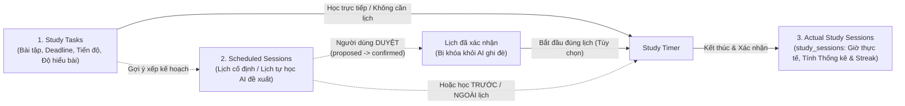

# EXAMPILOT – G8.8.3: PRODUCT RULES INTEGRATION

> **Mã tài liệu:** `g8_8_3_product_rules_integration.md`  
> **Cơ sở tham chiếu:** [`g8_8_1_architecture_decisions_study_experience.md`](file:///c:/Flutter%20PJ/exampilot/g8_8_1_architecture_decisions_study_experience.md) (đã cập nhật), [`g8_8_2_final_architecture_consistency_review.md`](file:///c:/Flutter%20PJ/exampilot/g8_8_2_final_architecture_consistency_review.md), [`lib/models/study_streak.dart`](file:///c:/Flutter%20PJ/exampilot/lib/models/study_streak.dart), [`lib/repositories/task_repository.dart`](file:///c:/Flutter%20PJ/exampilot/lib/repositories/task_repository.dart)  
> **Loại hình:** Product Rules & Architecture Alignment Specification (**DESIGN ONLY – Không sửa mã nguồn**)

---

## 1. CÁC QUYẾT ĐỊNH SẢN PHẨM CUỐI CÙNG (D1 – D6)

| Mã | Quyết định sản phẩm chính thức | Tác động trực tiếp lên hệ thống |
| :---: | :--- | :--- |
| **D1** | **Study Timer hỗ trợ cả học theo môn học và học theo công việc** | Bảng `study_sessions` luôn gắn `subject_id` (hoặc snapshot tên môn), cho phép `task_id = NULL` và `scheduled_session_id = NULL`. |
| **D2** | **Báo thức lặp âm thanh cho đến khi người dùng Tắt hoặc Nhắc lại** | Không có auto-timeout Dismiss. Chỉ dừng ở `Dismiss`, `Snooze` (tối đa 1 lần), hoặc `Start` (tuân thủ giới hạn phần cứng/OEM đã ghi nhận). |
| **D3** | **Phiên gián đoạn bắt buộc xác nhận Recovery 3 lựa chọn** | Mất tiến trình $\rightarrow$ `interrupted_pending`. Phân tách thời gian đã chốt tại Heartbeat và `unverified_gap`, tuyệt đối không tự cộng giờ app đóng. |
| **D4** | **Study Streak 15 phút học thực tế/ngày** | Cần $\ge 15$ phút (`900 giây`) học thực tế đã xác nhận (`study_sessions` trạng thái `completed`) trong 1 ngày địa phương (`study_date`). Tick task **KHÔNG** tăng Streak. |
| **D5** | **Phân tách tuyệt đối 3 khái niệm dữ liệu** | `Study Tasks` (mục tiêu/deadline) $\ne$ `Scheduled Sessions` (lịch kế hoạch/AI đề xuất) $\ne$ `Actual Study Sessions` (lịch sử ngồi học thực tế). |
| **D6** | **Lịch AI là đề xuất & Smart Rescheduling an toàn** | Người dùng phải duyệt trước khi lưu lịch đề xuất/bù; không đè lịch đã duyệt; không tự đổi deadline task; bù phần còn thiếu; giữ nguyên lịch sử khi hủy/đổi lịch. |

---

## 2. QUY TẮC STUDY STREAK & RÀ SOÁT MÃ NGUỒN HIỆN TẠI

### 2.1. Kết quả rà soát `study_streak.dart` và `task_repository.dart` hiện tại
Khi kiểm tra trực tiếp mã nguồn đang chạy (Schema v6):
1. Trong [`lib/repositories/task_repository.dart#L361-L382`](file:///c:/Flutter%20PJ/exampilot/lib/repositories/task_repository.dart#L361-L382) (`updateTaskStatus`): Hiện tại hễ người dùng tick hoàn thành 1 công việc, hàm lập tức gọi `recordTaskCompletion(...)`, chèn ngày hôm nay vào `study_activities` (dù `actualMinutes` là `0` hoặc `null`).
2. Trong [`lib/repositories/task_repository.dart#L551-L578`](file:///c:/Flutter%20PJ/exampilot/lib/repositories/task_repository.dart#L551-L578) (`getActiveStudyDates`): Hiện tại trả về `SELECT DISTINCT activity_date FROM study_activities` (và `_webActiveDates`). Do đó chỉ cần bấm tick 1 công việc là hệ thống **cộng thẳng +1 ngày Streak**, hoàn toàn chưa có ngưỡng thời gian thực tế 15 phút.
3. Trong [`lib/models/study_streak.dart#L52,L60,L89`](file:///c:/Flutter%20PJ/exampilot/lib/models/study_streak.dart#L89): Code hiện tại dùng `subtract(Duration(days: 1))` (trừ 86,400 giây) và `d.difference(prevDate).inDays` (chia chênh lệch mili giây cho 24 giờ) trên Local `DateTime(y, m, d)`. Trên thiết bị có quy ước giờ mùa hè (DST — ngày chỉ có 23h hoặc 25h), phép chia 24h sẽ làm nhảy sai 1 ngày hoặc mất chuỗi. Cần sửa sang **Pure Calendar-Day Stepping** (dùng bộ ngày lịch `(year, month, day)` và hàm lịch `previousCalendarDay` / `isNextCalendarDay`, **tuyệt đối không chia mili giây cho 24 giờ**) khi triển khai Phase 5.

### 2.2. Công thức Study Streak chính thức từ G8.8.4 (Phương án A + Bảo toàn Lịch sử)
$$\text{DailyStudySeconds}(d) = \sum_{\substack{s \in \text{study\_sessions} \\ s.\text{study\_date} == d \\ s.\text{status} = \text{'completed'}}} s.\text{verified\_study\_seconds}$$

$$\text{ActiveStreakDates} = \{ d \mid \text{DailyStudySeconds}(d) \ge 900 \}$$

- **Phương án A (Quy tắc duy nhất):** Verified Study Streak chỉ tính từ `study_sessions` (`completed`) có tổng $\ge 900\text{s}$ (`15 phút`) trong 1 ngày địa phương (`study_date`), cộng dồn nhiều phiên trong ngày, tối đa +1 Streak/ngày. **Không** tạo `study_session` giả từ `study_activities` / `actual_minutes` cũ và **không** tạo thêm cơ chế cộng Streak thứ hai.
- **Bảo toàn lịch sử cũ & Hiển thị chuyển tiếp:** Toàn bộ `study_activities` và ngày lịch sử trước nâng cấp được giữ nguyên (không xóa). Thẻ Streak hiển thị Streak chính thức ($\ge 15\text{p}$ Đồng hồ) kèm ghi chú chuyển tiếp nếu tồn tại dữ liệu lịch sử cũ *(tránh hiểu nhầm mất dữ liệu hoặc nhầm là đã xác minh bằng Timer)*.
- **Tick hoàn thành task KHÔNG tăng Streak:** `updateTaskStatus(completed)` vẫn ghi nhận `study_activity` để phục vụ Thống kê lượt hoàn thành công việc & Sổ cái thủ công, nhưng **`getActiveStudyDates()` sẽ ngừng lấy ngày từ việc tick hoàn thành task thông thường**.
- **Học ngoài lịch / Học vượt lịch AI:** Vẫn tạo bản ghi `study_sessions` (`scheduled_session_id = null` hoặc linked) với `status = 'completed'` nên được cộng dồn vào `DailyStudySeconds(d)` bình thường.
- **Phiên gián đoạn:** Khi ở trạng thái `interrupted_pending`, thời gian chưa xác nhận = `0` đối với Streak. Chỉ khi người dùng xác nhận qua Recovery Dialog chuyển thành `completed`, phần `verified_study_seconds` đã xác nhận mới được cộng vào `DailyStudySeconds(study_date)`.

### 2.3. Xử lý Múi giờ, DST, Phiên qua nửa đêm & Thay đổi ngày hệ thống (Chống tính trùng Streak)
| Tình huống biên | Cơ chế xử lý kỹ thuật | Bảo đảm |
| :--- | :--- | :--- |
| **1. Chuyển múi giờ thiết bị (VD: `+07:00` $\rightarrow$ `+09:00`)** | Timestamp lưu **UTC (`...Z`)**, còn `study_date` giữ cố định theo **ngày lịch địa phương lúc `started_at`** (`'YYYY-MM-DD'`). Khi đổi múi giờ, lấy `today` theo `DateTime.now().toLocal()`. | Các phiên cũ không bị viết lại hay tách đôi gây tính trùng. Lùi ngược ngày do qua đường đổi ngày không tự tạo thêm ngày Streak giả. |
| **2. Chuyển giờ mùa hè DST (Ngày 23h hoặc 25h)** | **Cấm chia mili giây cho 24 giờ** (`difference.inDays`) hay trừ `Duration(days: 1)`. Dùng **Pure Calendar-Day Stepping** trên bộ `(year, month, day)` theo đúng lịch Gregorian. | Chuyển đổi qua ngày 23h hay 25h luôn bước đúng 1 ngày lịch (`prev -> next`), không bao giờ mất ngày hay tạo ngày Streak giả. |
| **3. Phiên học qua nửa đêm (`23:30 11/11` $\rightarrow$ `00:15 12/11`)** | `study_date` được đóng dấu một lần lúc `Start` là `'2026-11-11'` và giữ nguyên khi hoàn thành. | Toàn bộ `45 phút` dồn vào ngày `'2026-11-11'`. Không xẻ đôi thành 2 ngày (tránh cộng oan +2 Streak cho 1 phiên, hoặc làm 15 phút bị xẻ thành 10p + 5p khiến cả 2 ngày đều trượt). |
| **4. Chỉnh ngày/giờ hệ thống trên máy** | - Trong cùng phiên: `ClockSkewDetector` dùng `Stopwatch` phát hiện lùi/nhảy giờ. - Sau reboot/kill: `now < last_heartbeat_at` đưa vào Recovery bắt buộc. - Chỉnh lại ngày cũ để học thêm: Gom chung vào `Set<String> ActiveStreakDates` theo `study_date`. | Không bao giờ cho phép cộng +2 Streak cho cùng 1 ngày lịch; `longestStreak` và `currentStreak` luôn tính từ `Set<String>` ngày duy nhất bằng Pure Calendar Stepping. |

---

## 3. PHÂN BIỆT 3 LOẠI DỮ LIỆU & QUY TẮC LỊCH ĐỀ XUẤT AI

| Tiêu chí so sánh | 1. `Study Tasks` (`study_tasks`) | 2. `Scheduled Sessions` (`scheduled_sessions` – G9.0) | 3. `Actual Study Sessions` (`study_sessions`) |
| :--- | :--- | :--- | :--- |
| **Bản chất** | **Việc cần làm / Khối lượng kiến thức** (Tên bài, môn học, deadline nộp, ước lượng). | **Kế hoạch thời gian dự kiến** trên lịch (Lịch trường cố định, lịch user tự đặt, hoặc lịch AI đề xuất). | **Sự kiện học thực tế đã diễn ra** do Study Timer đo hoặc xác nhận qua Recovery. |
| **Trạng thái vòng đời** | `todo`, `inProgress`, `completed` | `proposed` (AI gợi ý chờ duyệt), `confirmed` (đã chốt), `cancelled_by_user`, `skipped`, `completed` | `running`, `paused`, `in_break`, `interrupted_pending`, `completed`, `cancelled` |
| **Tác động đến Thống kê giờ & Streak** | Hoàn thành task **KHÔNG tự tăng Streak**, chỉ lưu số lượng bài xong và giờ nhập tay cũ. | **KHÔNG bao giờ** tính vào giờ học thực tế hay Streak (kể cả khi giờ hẹn đã qua). | Nguồn chân lý tính **Giờ học thực tế** và điều kiện **Streak $\ge 15\text{p}$/ngày**. |
| **Quyền kiểm soát của AI** | AI chỉ đọc làm đầu vào (deadline, độ khó, thời lượng dự kiến); **CẤM sửa deadline / xóa task**. | AI chỉ sinh bản ghi trạng thái `proposed` hoặc đề xuất điều chỉnh khi task xong sớm; **CẤM ghi đè lịch `is_locked_by_user = true`**. | **Chỉ đọc (Read-only)** đối với AI; AI không bao giờ được sửa hoặc xóa lịch sử học tập thực tế. |

---

## 4. CƠ CHẾ HỦY LỊCH & SMART RESCHEDULING (BÙ LỊCH THÔNG MINH)

### 4.1. Phân biệt rạch ròi 3 hành động hủy
1. **Hủy lịch (`cancelScheduledSession`):** Chuyển `scheduled_session.approval_status = 'cancelled_by_user'`. Task gốc vẫn còn nguyên, deadline giữ nguyên, lịch sử học không đổi. Sau đó mở dialog **3 lựa chọn Bù lịch**.
2. **Bỏ qua (`skipScheduledSession`):** Người dùng chọn *"Không bù buổi học"* $\rightarrow$ `approval_status = 'skipped'`, không đề xuất lịch thay thế.
3. **Hủy phiên Timer (`discardStudySession`):** Áp dụng trên `Actual Study Session` (`study_sessions.status = 'cancelled'`) khi đang chạy hoặc ở Recovery Dialog $\rightarrow$ không liên quan đến xóa/hủy kế hoạch lịch học.

### 4.2. Quy trình & Luật Thuật toán Đề xuất Lịch bù
Khi sinh viên hủy một buổi học dự kiến (`cancelled_by_user`) và muốn xếp bù:
- **Bước 1 – Cung cấp 3 lựa chọn UI:**
  1. **Đề xuất lịch bù tự động:** Chạy thuật toán bên dưới và hiển thị bản xem trước (`proposed`) để sinh viên bấm *Duyệt* hoặc *Từ chối*.
  2. **Tự chọn thời gian khác:** Cho phép sinh viên tự chọn ngày/giờ rảnh $\rightarrow$ lưu với `approval_status = 'confirmed'` và `is_locked_by_user = true`.
  3. **Không bù buổi học:** Chuyển sang `skipped`, giữ nguyên Task trong Kế hoạch.
- **Bước 2 – Công thức tính phần thời lượng còn thiếu (Partial Study Compensation):**
  - Với buổi học dự kiến $S_{\text{sched}}$ có thời lượng `planned_minutes` (VD: 60 phút):
  - Nếu buổi này đã có một phần thời gian thực tế hợp lệ trong `study_sessions` (VD: đã học được 20 phút rồi dừng/hủy phần lịch còn lại):
    $$\text{minutesToReschedule} = \max(0, S_{\text{sched}}.\text{planned\_minutes} - \text{studiedMinutesForSlot})$$
  - Kết quả: Chỉ đề xuất bù **40 phút còn thiếu**, không ép học lại toàn bộ 60 phút! Nếu task đã hoàn thành trước đó ($\text{remaining} == 0$) $\rightarrow$ Không cần bù, gợi ý đóng lịch.
- **Bước 3 – Quy tắc xếp khe giờ bù:**
  - **Thứ tự ưu tiên (Priority Queue):** `deadline` gần nhất $\rightarrow$ `TaskPriority` cao nhất $\rightarrow$ `UnderstandingLevel` thấp nhất (`needReview` ưu tiên cao).
  - **Tìm khe trống (No-Overlap Constraint):** Loại trừ toàn bộ giờ học cố định trên trường và toàn bộ `scheduled_sessions` đang `confirmed`. Không bao giờ xếp chồng lấn.
  - **Giới hạn thời gian học/ngày (`daily_study_limit_minutes = 240`):** Mặc định `240` phút/ngày (user tự sửa trong Cài đặt). Là **ngưỡng tham khảo DÀNH RIÊNG cho Smart Rescheduling/đề xuất AI**, **KHÔNG** giới hạn hay tự dừng Study Timer. Nếu ngày $d$ đã đạt $\ge 240$ phút (học thực tế + lịch đã chốt), AI không tự đề xuất thêm buổi thường vào ngày $d$ (trừ khi user tăng giới hạn hoặc tự chọn giờ). Nếu user chủ động học vượt 240 phút bằng Timer, vẫn ghi nhận đầy đủ 100%.
  - **Chia nhỏ phiên dài (Splitting / Chunking):** Nếu phần cần bù là 90 phút nhưng mỗi khe rảnh trong các ngày tiếp theo chỉ còn 45 phút $\rightarrow$ tự động chia thành `45p + 45p` ở 2 khe trống khác nhau.
  - **Cảnh báo trễ hạn & Bảo vệ Deadline:** Nếu trước `task.deadline` không còn đủ khe trống hợp lệ $\rightarrow$ **CẤM tự dời `task.deadline`**. Phải hiển thị cảnh báo đỏ: *"Cảnh báo nguy cơ trễ hạn trước [Deadline]: Thiếu [X] phút không xếp được vào khung giờ trống hiện tại."*
  - **Không sửa quá khứ:** Lịch bù chỉ tạo các `ScheduledSession` tương lai ($t \ge \text{now}$), tuyệt đối giữ nguyên mọi `study_sessions` lịch sử.

---

## 5. KIỂM CHỨNG 10 TÌNH HUỐNG NGHIỆP VỤ (CONSISTENCY SCENARIOS)

| STT | Tình huống kiểm thử | Trạng thái các bảng dữ liệu (`Tasks` / `Scheduled` / `Sessions`) | Kết quả mong đợi & Xác nhận tính nhất quán |
| :-: | :--- | :--- | :--- |
| **1** | Tick hoàn thành task nhưng không dùng Timer | `study_tasks.status = 'completed'`; `study_activities` có 1 dòng; `study_sessions` trống. | **Không tăng Study Streak** (0 giây Timer < 900s). Thống kê vẫn đếm +1 bài hoàn thành. |
| **2** | Học 10p + 5p trong hai phiên cùng ngày | `S1`: `600s` (`completed`), `S2`: `300s` (`completed`), cùng `study_date`. | Tổng ngày = `900s` (15 phút) $\ge 900\text{s}$ $\rightarrow$ **Đạt +1 ngày Streak**. |
| **3** | Học 60p trong một phiên | `S1`: `3600s` (`completed`), `study_date = '2026-11-11'`. | Tập `ActiveStreakDates` chứa duy nhất `'2026-11-11'` $\rightarrow$ **Chỉ +1 ngày Streak**. |
| **4** | Học trước lịch AI (Hẹn 20:00, học lúc 14:00) | `S1` lúc 14:00 (`completed`, 25p, `scheduled_session_id = null`). Lịch 20:00 vẫn là `confirmed`. | `S1` **vẫn tính 25p Thống kê & +1 Streak**. Hệ thống chỉ *gợi ý* điều chỉnh/hủy ca 20:00 nếu task đã đủ giờ, chờ user duyệt. |
| **5** | Hủy lịch nhưng tự học task đó vào lúc khác | Lịch cũ: `cancelled_by_user`. Học lúc khác tạo `S2` (`completed`, 30p, gắn `task_id`). | Lịch cũ không reo chuông. `S2` **ghi nhận đủ 30p vào Thống kê & tính Streak bình thường**. |
| **6** | Hủy lịch và chọn "Không bù buổi học" | Lịch cũ chuyển `skipped`. `study_tasks` không bị đụng tới. | **Task vẫn tồn tại nguyên vẹn** (tên, deadline, độ ưu tiên, ghi chú). |
| **7** | Hủy buổi học 60p sau khi đã học 20p | `S1` đã chốt 20p (`completed`). Buổi lịch `planned = 60p` bị hủy phần còn lại. | 20p vẫn nằm nguyên trong lịch sử & Streak. Thuật toán Smart Rescheduling chỉ tính `remaining = 60 - 20 = 40 phút` để đề xuất bù. |
| **8** | Hai task cùng deadline gần | `Task A` (`high`, `needReview`, 40p) & `Task B` (`medium`, `good`, 40p) cùng hạn mai. | Xếp `Task A` vào khe rảnh 1, `Task B` vào khe rảnh 2 tiếp theo (hoặc ngày khác nếu chạm `daily_study_limit_minutes`), **không xếp chồng**, cảnh báo nếu thiếu giờ. |
| **9** | Người dùng đổi lịch đề xuất | Sửa `scheduled_start_at/end_at` trên bảng `scheduled_sessions`. | Bảng `study_sessions` hoàn toàn độc lập nên **lịch sử phiên học thực tế không thay đổi**. |
| **10** | Khôi phục từ Backup | Import JSON qua Pipeline 7 bước (Backup v2 hoặc v1). | Toàn bộ môn/task/sessions/scheduled được nạp trong 1 Transaction ACID; phiên dở giữ `interrupted_pending`; **Streak tự tính lại chuẩn xác theo quy tắc 15p/ngày trên dữ liệu đã khôi phục**. |

---

## 6. CÁC QUYẾT ĐỊNH CHUYỂN TIẾP ĐÃ ĐƯỢC CHỐT TẠI G8.8.4 (CLOSED)

Hai điểm chờ xác nhận ở G8.8.3 nay đã được người dùng phê duyệt chính thức trong G8.8.4:

1. **Chính sách bảo lưu Streak cho dữ liệu/Backup v1 cũ (Chốt Phương án A + Bảo toàn Lịch sử cũ):**
   - Verified Study Streak theo quy tắc mới **chỉ tính từ `study_sessions` (`completed`) đạt $\ge 900\text{s}$/ngày**. Không tạo session giả từ `study_activities` hay `actual_minutes` cũ, và không tạo cơ chế cộng Streak thứ hai.
   - Tuy nhiên, toàn bộ bảng `study_activities` và ngày lịch sử cũ được **giữ nguyên 100%** khi nâng cấp hay khôi phục Backup (hiển thị phân tách rõ ràng với chú thích chuyển tiếp trên UI để user không hiểu nhầm mất dữ liệu hay nhầm đã xác minh bằng Timer).

2. **Chế độ mặc định `daily_study_limit_minutes = 240` (Đã chốt):**
   - Đặt mặc định **`240` phút/ngày** trong `user_profile` làm ngưỡng tham khảo cho Smart Rescheduling G9.0 (người dùng tự chỉnh trong Cài đặt). **Tuyệt đối không giới hạn hay tự dừng Study Timer**.

---

## 7. ROADMAP TRIỂN KHAI ĐÃ ĐIỀU CHỈNH (CẬP NHẬT TỪ G8.8.4)

- **Phase 1 – Nền tảng CSDL v7 & Overview Weekly Goal:** Bảng `study_sessions` (thêm `scheduled_session_id` nullable), `onConfigure` Foreign Keys, mở rộng `user_profile` (âm thanh, nhắc nhở, `daily_study_limit_minutes = 240`), `WebSessionStorage`, `SessionRepository`, thẻ `WeeklyGoalSummaryCard`.
- **Phase 2 – Study Timer Engine & Recovery:** `StudyTimerController` theo mô hình **Single Checkpoint Anchor**, Lifecycle sync, Recovery Dialog 3 lựa chọn.
- **Phase 3 – Timer UI, Floating Mini-Bar & Break Cycles:** `TimerScreen`, `FloatingTimerBar` trên 5 tab hiện tại, cấu hình 25/5, 50/10, 90/15, Custom.
- **Phase 4 – Notification, Alarm State Machine & Audio:** `NotificationService`, `AlarmService` (không auto-timeout Dismiss, Snooze max 1 lần), 8 Fixed Notification Channels, 6 âm thanh + Mute + Preview + Fallback.
- **Phase 5 – Thống kê Disjoint Ledgers, Study Streak Phương án A & Backup v2:** Cập nhật `StudyStatisticsCalculator`, cập nhật **`StudyStreak`** (ngưỡng $\ge 900\text{s}$/ngày từ `study_sessions`, áp dụng **Pure Calendar-Day Stepping** chống DST/múi giờ, bảo toàn lịch sử cũ `study_activities` + UI chú thích chuyển tiếp, ngừng cộng Streak khi tick task, cập nhật lại unit tests ở `overview_and_streak_test.dart`), UI `TaskAssessmentDialog` tách biệt, và Backup v2 Pipeline 7 bước.
- **Phase 6 – Smart Timetable & Smart Rescheduling (G9.0):** Triển khai `ScheduledSession`, phân tách 3 thực thể, UI duyệt lịch AI (`proposed` $\rightarrow$ `confirmed`), thuật toán `TimetableScheduleResolver` và `SmartRescheduler` (xét `daily_study_limit_minutes`, bù phần thiếu, không đè lịch chốt, cảnh báo trễ hạn).

---

## 8. XÁC NHẬN TÍNH TƯƠNG THÍCH VỚI G8.8.2

| Quy tắc G8.8.2 đã duyệt | Trạng thái trong G8.8.3 | Ghi chú đối chiếu |
| :--- | :---: | :--- |
| **`study_date` lấy theo giờ địa phương tại `started_at`** | **Tương thích 100%** | Là nền tảng để gom tổng giây học trong ngày tính Streak 15p và xử lý phiên qua nửa đêm không bị xẻ đôi. |
| **Thời gian thủ công & Timer lưu/hiển thị riêng** | **Tương thích 100%** | Timer không bao giờ ghi đè `actual_minutes`. Thống kê cộng đúng 2 sổ cái tách biệt. |
| **Alarm không auto-timeout & Snooze max 1 lần** | **Tương thích 100%** | Giữ nguyên trạng thái State Machine `Ringing` và giới hạn OEM/Web đã công bố. |
| **Recovery hỏi xác nhận 3 lựa chọn** | **Tương thích 100%** | Đảm bảo thời gian `interrupted_pending` chưa xác nhận không được tính vào cả Thống kê lẫn Streak 15p. |

---
*Hoàn tất G8.8.3 – Toàn bộ tài liệu G8.8.1 đã được cập nhật và báo cáo G8.8.3 đã sẵn sàng chờ bạn xem xét, phê duyệt trước khi bắt đầu Phase 1.*
